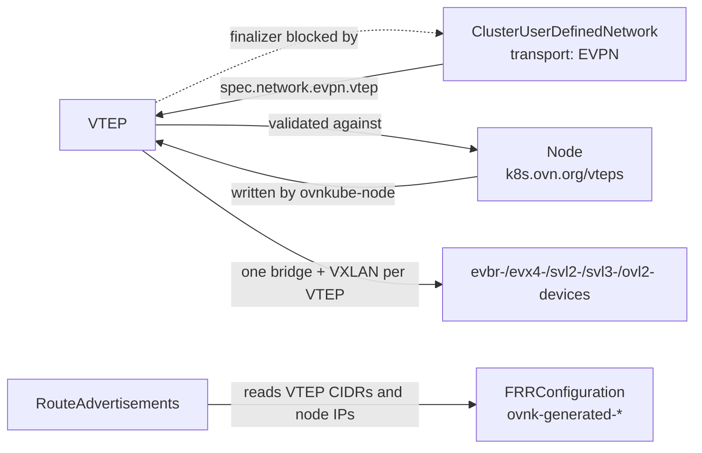

# 04 — API: VTEP

The `VTEP` custom resource declares where the VXLAN Tunnel Endpoint addresses
of the nodes come from. It is the only cluster-scoped EVPN-specific resource;
the per-network EVPN settings live inside `ClusterUserDefinedNetwork`
([05](05-api-cudn-transport.md)).

## Contents

1. [Where the API lives](#where-the-api-lives)
2. [Object shape](#object-shape)
3. [Field reference](#field-reference)
4. [Admission-time validation (CEL)](#admission-time-validation-cel)
5. [Status contract](#status-contract)
6. [The node annotation `k8s.ovn.org/vteps`](#the-node-annotation-k8sovnorgvteps)
7. [Lifecycle: finalizer and deletion](#lifecycle-finalizer-and-deletion)
8. [Relationships with other objects](#relationships-with-other-objects)
9. [Review notes](#review-notes)

---

## Where the API lives

| Artifact | Path |
|---|---|
| Go types | `go-controller/pkg/crd/vtep/v1/types.go` |
| Generated clients | `go-controller/pkg/crd/vtep/v1/apis/` |
| Rendered API reference | `docs/api-reference/vtep-api-spec.md` |
| Informer registration | `go-controller/pkg/factory/factory.go:1959` (`VTEPInformer`), only when `util.IsEVPNEnabled()` |
| Node annotation helpers | `go-controller/pkg/util/vtep_node_annotations.go` |

Group `k8s.ovn.org`, version `v1`, kind `VTEP`, plural `vteps`, cluster
scoped, status subresource, printer columns `Accepted` and `Reason`
(`types.go:137-142`).

---

## Object shape

```go
// go-controller/pkg/crd/vtep/v1/types.go:143-155
type VTEP struct {
	metav1.TypeMeta   `json:",inline"`
	metav1.ObjectMeta `json:"metadata,omitempty"`
	Spec   VTEPSpec   `json:"spec"`
	Status VTEPStatus `json:"status,omitempty"`
}

// types.go:160-190
type VTEPSpec struct {
	CIDRs []CIDR   `json:"cidrs"`
	Mode  VTEPMode `json:"mode,omitempty"` // Managed | Unmanaged, defaults to Managed
}
```

```yaml
apiVersion: k8s.ovn.org/v1
kind: VTEP
metadata:
  name: evpn-vtep
spec:
  cidrs:
  - 100.64.0.0/24
  mode: Unmanaged
```

---

## Field reference

### `spec.cidrs` (required, 1 to 20 entries)

The address ranges VTEP IPs are taken from. The doc comment at
`types.go:161-173` is the authoritative description. Summarised:

- Each node ends up with **at most one IP per address family** across all
  listed CIDRs.
- In `Unmanaged` mode the node side discovers an address that already exists
  on the node inside these ranges (see [16 — Node EVPN datapath](16-ovnkube-node-evpn-datapath.md#vtep-ip-discovery)).
  Ambiguity is resolved deterministically; the CRD comment says a failed
  status results, the implementation picks the lowest non-VIP address
  (`evpn_node_controller.go:896-931`).
- In `Managed` mode the intent is allocation by the cluster manager, but the
  cluster manager currently rejects it (`vtep/controller.go:157-159`,
  reason `ManagedModeNotSupported`) and the node deletes any devices for it
  (`evpn_node_controller.go:364-370`).
- CIDRs are append-only in `Managed` mode (CEL on the spec), free in
  `Unmanaged` mode.

### `spec.mode` (optional, defaults to `Managed`)

`VTEPModeManaged` or `VTEPModeUnmanaged` (`types.go:201-207`). Because the
default is `Managed` and `Managed` is not implemented, **every working VTEP
today explicitly sets `mode: Unmanaged`**.

---

## Admission-time validation (CEL)

| Location | Rule | Message |
|---|---|---|
| `types.go:158` | `self.mode != 'Managed' \|\| size(self.cidrs) >= size(oldSelf.cidrs)` | CIDRs cannot be removed in managed mode; only appending new CIDRs or expanding the existing CIDRs is allowed |
| `types.go:159` | existing CIDRs keep position and may only widen (`prefixLength() <= old`) in managed mode | In managed mode, existing CIDRs must remain at the same position and can only be expanded to a wider mask; shrinking the mask or reordering is not allowed |
| `types.go:177` | pairwise `!(cidr(a).containsIP(cidr(b).ip()) \|\| cidr(b).containsIP(cidr(a).ip()))` | CIDRs must not overlap with each other |
| `types.go:193` | `isCIDR(self) && cidr(self) == cidr(self).masked()`, `MaxLength=43` | CIDR must be a valid network address |
| `types.go:175-176` | `MinItems=1`, `MaxItems=20` | |

Overlap **across** VTEP objects is not a CEL concern; the cluster manager
checks it (`vtep/controller.go:313-359`).

---

## Status contract

```go
// types.go:210-218
type VTEPStatus struct {
	Conditions []metav1.Condition `json:"conditions,omitempty"`
}
```

A single condition type `Accepted`, written with server-side apply by field
manager `clustermanager-vtep-controller` (`vtep/status.go:589-653`). Reasons:

| Status | Reason (`status.go:593-597`) | Set when |
|---|---|---|
| `True` | `Allocated` | Every node has an entry with at least one IP for this VTEP in `k8s.ovn.org/vteps` |
| `False` | `ManagedModeNotSupported` | `spec.mode == Managed` |
| `False` | `CIDROverlap` | Any CIDR overlaps a CIDR of another live VTEP; the message lists them as `CIDRs overlap with VTEPs: [a, b]` |
| `False` | `EVPNIPv6NotSupported` | The VTEP has an IPv6 CIDR **and** at least one EVPN CUDN references it |
| `False` | `AllocationFailed` | At least one node is missing the annotation, the VTEP entry, or has an empty IP list; the message joins one line per failing node |

Each `False` transition also emits a Warning event on the VTEP once per
distinct message (`vtep/controller.go:161-200`).

A gauge mirrors the condition:
`ovnkube_clustermanager_vtep_condition{name,condition,status}`
(`metrics/cluster_manager.go:154-161`), registered only when EVPN is enabled.

`Accepted=True` is a precondition for the referencing CUDN to be accepted
(`userdefinednetwork/transport_validation.go:203-222`) and for its NADs to be
rendered.

---

## The node annotation `k8s.ovn.org/vteps`

The annotation is the hand-off between the node that owns the addresses and
the two control-plane readers.

```json
{"evpn-vtep": {"ips": ["100.64.0.1"]}, "other-vtep": {"ips": ["100.65.0.1", "fd00:100::1"]}}
```

| Function | File | Role |
|---|---|---|
| `ParseNodeVTEPs` | `util/vtep_node_annotations.go:32` | Lenient parse, returns `AnnotationNotSetError` when absent |
| `ValidateNodeVTEPs` | `util/vtep_node_annotations.go:46` | Strict parse of selected entries only: IP syntax, no zone, global unicast after unmapping IPv4-mapped IPv6, at most one address per family; returns canonical addresses |
| `MarshalNodeVTEPs` | `util/vtep_node_annotations.go:89` | Serialise, or set the key to `nil` to remove it when the map is empty |
| `NodeVTEPsAnnotationChanged` | `util/vtep_node_annotations.go:105` | Used by every `ObjNeedsUpdate` that cares about VTEP IPs |

Writer: the EVPN node controller in ovnkube-node, field manager
`node-vtep-controller` (`evpn_node_controller.go:68`, `:847-894`).

Readers:

- Cluster manager VTEP controller, to decide `Allocated` versus
  `AllocationFailed` (`vtep/controller.go:414-443`).
- Cluster manager RouteAdvertisements controller, to advertise each node's
  VTEP host route and to detect two nodes claiming the same address
  (`routeadvertisements/controller.go:789-846`, `:1207-1230`).

Neither reader repairs the annotation. Repair is a node-side responsibility
triggered by any change to the annotation value
(`evpn_node_controller.go:266-288`).

---

## Lifecycle: finalizer and deletion

- `k8s.ovn.org/vtep-protection` is added to every non-deleting VTEP on first
  reconcile, unconditionally, to avoid a race between a CUDN starting to
  reference the VTEP and the VTEP being deleted (`vtep/controller.go:212-225`).
- On deletion, the finalizer is removed only when no CUDN has
  `spec.network.evpn.vtep == <name>` (`vtep/controller.go:227-254`). The
  controller does not retry; it is re-queued by `onCUDNDeleted` when the last
  referencing CUDN goes away (`vtep/controller.go:506-512`).
- Once the finalizer is gone, the node controller observes the VTEP
  disappearing, deletes the bridge, VXLAN devices, SVIs and OVS ports and
  removes its annotation entry (`evpn_node_controller.go:355-362`).

---

## Relationships with other objects



- A VTEP is shared by every EVPN CUDN that names it. All of them share one
  Linux bridge and one VXLAN device per address family on each node; VLAN IDs
  separate them. This is the Single VXLAN Device model
  ([01 — Concepts](01-concepts.md#single-vxlan-device-svd)).
- VNIs must be unique **per VTEP** (`userdefinednetwork/controller.go:89-92`,
  `vniKey{vtep, vni}`), not globally.

---

## Review notes

- `cudnNeedsUpdate` in the VTEP controller only admits **creates** of EVPN
  CUDNs (`vtep/controller.go:518-523`); CUDN specs are immutable so updates
  are irrelevant, and deletes go through `OnDelete`.
- `nodeNeedsUpdate` ignores node creates and only reacts to annotation value
  changes (`vtep/controller.go:547-552`). A node that joins already annotated
  is covered because every VTEP reconcile lists all nodes.
- `validateCIDRsAcrossVTEPs` parses every VTEP's CIDRs on every reconcile; the
  code comment at `vtep/controller.go:310-312` flags this as the first thing
  to cache if VTEP counts grow.
- Changing the annotation format means changing `ValidateNodeVTEPs` and
  `ParseNodeVTEPs` together with the node writer, and both readers' tests
  (`routeadvertisements/controller_test.go:351`, `vtep/controller_test.go`).
