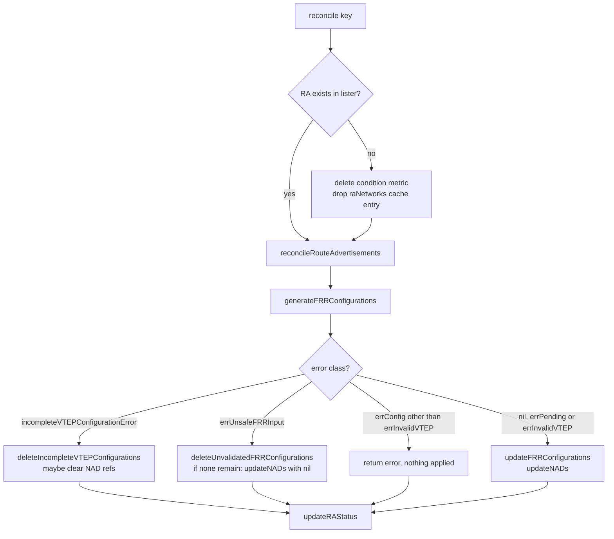

# 07 — Cluster manager: the RouteAdvertisements controller

Package `go-controller/pkg/clustermanager/routeadvertisements`. This is the
controller that turns a `RouteAdvertisements` into per-node `FRRConfiguration`
objects and into the NAD annotation every other component keys off. It is the
most important reconciler of the feature and the one most PRs touch.

Line numbers refer to `controller.go`, `rawconfig.go` and `validation.go` in
that package at upstream `master` commit `654e2915f`.

## Contents

1. [Position in the cluster manager](#position-in-the-cluster-manager)
2. [Inputs, outputs and side effects](#inputs-outputs-and-side-effects)
3. [Sub-controllers and event filters](#sub-controllers-and-event-filters)
4. [The reconcile cycle, step by step](#the-reconcile-cycle-step-by-step)
5. [generateFRRConfigurations in detail](#generatefrrconfigurations-in-detail)
6. [generateFRRConfiguration: one source, one node](#generatefrrconfiguration-one-source-one-node)
7. [Applying the desired state](#applying-the-desired-state)
8. [Validation and error classes](#validation-and-error-classes)
9. [VTEP claim conflict detection](#vtep-claim-conflict-detection)
10. [Dynamic UDN allocation interactions](#dynamic-udn-allocation-interactions)
11. [DPU and Uplink interactions](#dpu-and-uplink-interactions)
12. [Concurrency model](#concurrency-model)
13. [Complexity](#complexity)
14. [Unit tests to know](#unit-tests-to-know)

---

## Position in the cluster manager

Constructed and started by `ClusterManager` only when
`util.IsRouteAdvertisementsEnabled()` (`clustermanager/clustermanager.go:223-224`,
`:318`). It receives the cluster manager's network manager, the watch factory
and the typed clientsets (`NewController`, `controller.go:166-170`).

It runs in the ovnkube-cluster-manager process, which is a single leader-elected
instance. There is therefore exactly one writer of generated
`FRRConfiguration`s and of the NAD annotation in the cluster.

---

## Inputs, outputs and side effects

Inputs (all through informer listers, never direct API reads):

| Input | Lister | Why |
|---|---|---|
| `RouteAdvertisements` | `raLister` | the intent |
| `FRRConfiguration` | `frrLister` | templates; also all generated objects for diffing and conflict evidence |
| `NetworkAttachmentDefinition` | `nadLister` | selected networks, through the network manager's `GetNetwork` |
| `Node` | `nodeLister` | node selection, host subnets annotation, VTEP annotation, InternalIPs, DPU and gateway annotations |
| `EgressIP`, `Namespace` | `eipLister`, `namespaceLister` | only when `EnableEgressIP` |
| `VTEP` | `vtepLister` | only when `IsEVPNEnabled()` |
| `UplinkState` | `uplinkStateLister` | only when `IsUplinkEnabled()` |
| Network manager | `nm` | `GetNetwork`, `NodeHasNetwork`, `GetActiveNetworkForNamespaceFast`, `GetNADKeysForNetwork`, activity notifications |

Outputs:

| Output | Call |
|---|---|
| Create / update / delete `FRRConfiguration` | `frrClient.ApiV1beta1().FRRConfigurations(ns)` in `updateFRRConfigurations` (`:1924`) |
| Patch NAD annotation `k8s.ovn.org/route-advertisements` | `kube.KubeOVN.SetAnnotationsOnNAD` in `updateNADs` (`:2021`) |
| Apply RA `status` | `raClient.K8sV1().RouteAdvertisements().ApplyStatus` in `updateRAStatus` (`:2091`) |
| Create the default network NAD if absent | `util.EnsureDefaultNetworkNAD` in `getSelectedNADs` (`:2171`) |
| Metric `route_advertisement_condition` | `metrics.RecordRouteAdvertisementCondition` |

---

## Sub-controllers and event filters

`NewController` builds up to seven level-driven controllers from
`go-controller/pkg/controller` and one network-manager registration. All run
with `Threadiness: 1` and the default typed rate limiter.

| Name | Watches | `ObjNeedsUpdate` | Reconcile handler |
|---|---|---|---|
| `clustermanager routeadvertisements controller` | RA | `c.raNeedsUpdate` (`:2277`): generation changed; with EVPN enabled it also calls `ReconcileAll()` so sibling RAs re-evaluate VTEP claims | `c.reconcile` (`:393`) |
| `... frrconfiguration controller` | FRRConfiguration | `frrConfigurationNeedsUpdate` (`:2298`): ignore own updates unless EVPN is on and the object is generated; otherwise generation, labels or the RA annotation changed | `reconcileFRRConfiguration` (`:2376`): `ReconcileAll()` plus the owning RA named by the label |
| `... nad controller` | NAD | `nadNeedsUpdate` (`:2311`): ignore own updates; only default or primary Layer2/Layer3 NADs; labels or RA annotation changed | `reconcileNAD` (`:2403`): `ReconcileAll()` plus every RA listed in the annotation |
| `... node controller` | Node | `nodeNeedsUpdate` (`:2339`): labels, `status.addresses`, subnet annotation, Layer2 tunnel ID annotation, DPU host address, L3 gateway config, chassis ID, VTEP annotation | `ReconcileAll()` |
| `... uplinkstate controller` (Uplink feature) | UplinkState | status changed | `ReconcileAll()` |
| `... egressip controller` (EgressIP feature) | EgressIP | status or namespace selector changed, or items appeared/disappeared | `reconcileEgressIPs` (`:2454`): every RA advertising `EgressIP` |
| `... namespace controller` (EgressIP feature) | Namespace | labels changed on update only | `reconcileEgressIPs` |
| Network activity | network manager `RegisterNetworkRefReconciler` (`:296-306`) | n/a | the RAs cached as selecting that network (`getRAsForNetwork`) |

`OnDelete` for RAs (`onRADelete`, `:2286`) triggers `ReconcileAll()` under
EVPN so a deleted RA releases its VTEP claims in the others' evaluation.

`ReconcileAll()` lists every RA and enqueues each key
(`pkg/controller/controller.go:354-372`). The workqueue de-duplicates keys, so
a burst of node events costs at most one reconcile per RA per burst, but
**every** RA is reconciled regardless of whether the event concerned it. The
cost model is discussed in [18 — Performance and scale](18-performance-and-scale.md).

`ReconcileNetwork` (`:340`) is the hook the cluster manager's network manager
calls when a network's `NetInfo` changes. It only reacts to the set of served
namespaces changing and funnels the event through the NAD controller, which
then fans out.

---

## The reconcile cycle, step by step



1. **Lookup** (`:400-408`). A missing RA is not an error: the controller
   still runs the apply path with a nil RA so that `updateFRRConfigurations`
   deletes everything labelled with the name and `updateNADs` removes the name
   from every NAD annotation. The condition metric is deleted and the
   `raNetworks` cache entry dropped.
2. **Generate** (`:420-423`). `generateFRRConfigurations` returns the full
   desired set of generated objects, the selected NADs and a classified error.
3. **Classify and apply** (`:424-480`). The table in the diagram above is the
   exact decision order of `reconcileRouteAdvertisements`. Note the two cases
   where a sanitized desired state is still applied despite an error:
   `errPending` (so partial progress such as a subset of nodes is written) and
   `errInvalidVTEP` (so a bad annotation on one node withdraws that node and
   keeps the others).
4. **Status** (`:415`, `:2091-2164`). `updateRAStatus` is called even when
   the error is operational; it computes the `Accepted` condition, compares
   it with the stored one through `util.MergeStatusCondition`, and applies
   only when the condition changed or when any object was created, updated or
   deleted in this cycle (`updateStatus := changed || hadUpdates`).
5. **Retry policy** (`:410-413`). `errConfig` and `errPending` are swallowed
   (returned as nil to the workqueue after the status write) because only a
   new event can resolve them. Any other error is returned, which makes the
   workqueue retry with backoff up to `MaxAttempts`, after which
   `HandleError` (`:181-194`) writes `InternalError` to the status.

The duration of each cycle is logged at V(4) as
`Finished syncing routeadvertisements "<name>", took <d>` (`:396-398`). There
is no histogram for it today.

---

## generateFRRConfigurations in detail

`controller.go:560-1027`. Read it as six phases.

### Phase 1: spec-level checks (`:565-576`)

- `EgressIP` requires the EgressIP feature.
- `EgressIP` with `targetVRF: auto` is rejected.
- A literal `targetVRF` must be a valid interface name (`errUnsafeFRRInput`).

### Phase 2: network selection (`:580-694`)

`getSelectedNADs` resolves `networkSelectors` to NADs; the list is sorted by
`namespace/name` so that errors and output are deterministic. For each NAD:

- `nm.GetNetwork(name)` may return nil if the network manager has not seen
  the NAD yet; such NADs are skipped silently, and the RA ends up
  `ConfigurationPending: no networks selected` if none resolves (`:584-586`).
- The network must be the default network or a primary network, and of
  Layer2 or Layer3 topology (`:614-619`).
- `EgressIP` cannot be combined with a Layer2 network (`:621-623`).
- The VRF name from `util.GetNetworkVRFName` must be a valid interface name,
  and two selected networks cannot map to the same VRF (`:625-631`).
- EVPN settings are captured into `vrfConfig` / `ipVRFConfig` through the
  validating constructors; IP families of the subnets decide which
  `advertise ipvX unicast` lines will be emitted (`:644-663`).
- An EVPN network forces `targetVRF` to be `auto` or its own VRF (`:665-668`).
- Subnets are recorded with their host prefix length (used later for
  no-overlay `toReceive` filters) (`:670-678`).

The resulting `selectedNetworks` struct (`:495-535`) is the working set for
the rest of the function. All its slices are sorted, and the comment at
`:685-690` explains why the per-RA network set is cached even on early
return: the cache must describe what is currently deployed.

### Phase 3: node and template selection (`:697-759`)

- `nodeSelector` must be empty when `PodNetwork` is advertised.
- Nodes are listed, sorted, and a `nodeToFRRConfig` map is seeded.
- Templates are listed by `frrConfigurationSelector`, sorted, generated ones
  skipped, and each template is attached to every selected node its own
  `nodeSelector` matches. The union of router VRFs across templates is kept
  as `frrRouterVRFs`.

Three `errPending` exits live here: no nodes, no templates.

### Phase 4: EVPN prerequisites and VTEP state (`:761-846`)

- EVPN networks require the feature flag, local gateway mode, a default-VRF
  router in some template, and for every IP-VRF either a router for its VRF
  or the default-VRF router to derive one from (`:762-787`).
- VTEP objects named by the networks are fetched; their CIDRs are parsed and
  deduplicated (`:792-806`).
- For every selected node, `getNodeVTEPPrefixes` (`:1207-1230`) validates the
  annotation entries for the referenced VTEPs and turns them into `/32` or
  `/128` host prefixes. Missing annotation means the node is skipped silently;
  an invalid entry puts the node in `invalidVTEPNodes` and records an
  `errInvalidVTEP`.
- `generationError` (`:818-828`) wraps any later error into an
  `incompleteVTEPConfigurationError` when invalid nodes exist, so the caller
  can withdraw those nodes even if generation fails for another reason.
- Conflict detection across RAs runs here, see
  [VTEP claim conflict detection](#vtep-claim-conflict-detection).

### Phase 5: per-node prefix gathering (`:848-990`)

Helpers with per-reconcile memoisation:

- `getHostSubnets` parses `k8s.ovn.org/node-subnets` once per node (`:850-868`).
- `getEgressIPsByNode` computes `node -> network -> egress IPs` once per
  reconcile (`:870-881`, `getEgressIPsByNodesByNetworks` `:2207-2269`): for
  each EgressIP, each assigned status item, each namespace matched by its
  namespace selector, the namespace's active network is looked up and, if
  selected, the IP is added.
- `getPrefixes` (`:883-925`) assembles the advertised prefix list for one
  (node, network): host subnets for Layer3 and default, network subnets for
  Layer2, plus egress IPs.

Then, for every node in sorted order:

- Nodes in `invalidVTEPNodes` are excluded from the desired state so that
  their previously generated objects are deleted (`:936-939`).
- For every selected network, the node is skipped when
  `nm.NodeHasNetwork(node, network)` is false (dynamic UDN allocation) or,
  for legacy Layer2 topology, when the node has no tunnel ID allocation
  (`:948-970`).
- `hostSubnets` is the deduplicated union across networks; a node with
  nothing to advertise is skipped (`:979-985`).
- For every template attached to the node, `generateFRRConfiguration` is
  called. A nil result means no router matched; with `targetVRF: auto` that
  is tolerated when the template only references networks inactive on this
  node (`frrConfigOnlyMatchesInactiveNetworks`, `:1247-1267`), otherwise it is
  a `ConfigurationError` (`:1000-1014`).
- With `targetVRF: auto`, every network active on the node must have been
  matched by some template (`:1016-1019`).

### Phase 6: return (`:1025-1026`)

Returns the generated list, the NADs and the joined VTEP validation errors
(nil when there were none).

---

## generateFRRConfiguration: one source, one node

`controller.go:1269-1750`. Produces at most one generated object for the pair.

```mermaid
flowchart TD
    S[for each source router] --> M{router.vrf matches<br/>targetVRF rule?}
    M -- no --> S
    M -- yes --> P[copy router<br/>prefixes = advertise set]
    P --> N[for each neighbor:<br/>validate id, skip self (managed template),<br/>reject dualStack,<br/>toAdvertise = family-filtered prefixes,<br/>DPU next hop,<br/>no-overlay toReceive]
    N --> Q{any neighbor kept?}
    Q -- no --> S
    Q -- yes --> R[append router]
    R --> I{targetVRF == auto?}
    I -- yes --> S
    I -- no --> L[add imports and reciprocal import routers]
    L --> S
    S --> E[EVPN: find/create IP-VRF routers,<br/>mark MAC-VRF networks matched,<br/>add VTEP host routes to default router]
    E --> W[generateRawConfig]
    W --> O{routers empty and raw empty?}
    O -- yes --> Z[return nil]
    O -- no --> Y[build FRRConfiguration with label, key annotation, validated annotation, hostname selector, raw priority 10]
```

Details that matter when reviewing:

- **Router matching** (`:1286-1325`) is the single place where `targetVRF`
  semantics live. `matchedNetworks` is filled here and is what phase 5 uses
  to check completeness under `auto`.
- **Managed template self-peer filtering** (`:1353-1369`, skip at `:1400-1403`): only for the
  template named `types.ManagedBGPConfigurationName` in
  `config.ManagedBGP.FRRNamespace`, the node's own InternalIPs are removed from
  the neighbor list. A node without InternalIPs returns an operational error
  (not `errPending`) so the reconcile is retried instead of applying an
  empty set that would withdraw everyone's routes.
- **Family filtering** (`:1423-1437`): an address-defined neighbor only gets
  prefixes of its own family; an interface-defined neighbor gets both.
- **No-overlay receive filter** (`:1454-1478`): when any selected network is
  no-overlay, every neighbor gets a `toReceive` allow list of each no-overlay
  pod subnet with `ge == le == hostSubnetLength`. This is what lets node A
  accept node B's `/24` from a `/16` cluster subnet.
- **Imports** (`:1494-1531`): only when `targetVRF` is not `auto`.
- **EVPN** (`:1533-1609`): if no default-VRF router was matched but EVPN is
  needed, the default router's ASN and neighbors are taken from the source
  anyway, because the EVPN raw section must name them. IP-VRF routers are
  found in the source or synthesised with the underlay ASN. MAC-VRF-only
  networks are considered matched as soon as a default router with neighbors
  exists.
- **VTEP host routes** (`:1611-1709`): appended to the default router's
  `prefixes` and `toAdvertise`, with `toReceive` selectors for the VTEP CIDRs;
  if the default router was not part of the generated set (literal
  `targetVRF`), a clone carrying only VTEP routes is created.
- **Identity** (`:1711-1748`): label, key annotation, validated annotation,
  hostname node selector, and `Spec = source.Spec` first so that unknown
  fields are inherited.

---

## Applying the desired state

### `updateFRRConfigurations` (`:1924-2019`)

1. List existing objects labelled with the RA name and index them by the key
   annotation.
2. For each desired object: create if no existing key, otherwise take the
   last existing one, skip if `Spec` and validated annotation are equal,
   otherwise `Update` with its name and resource version. Extra objects with
   the same key are left in the index and deleted in step 3.
3. Delete every existing object not consumed in step 2.

Returns `hadUpdates`, which feeds the status write decision. Any API error
aborts the loop and is returned as operational, so the whole reconcile is
retried; objects already written stay.

### `updateNADs` (`:2021-2089`)

Iterates **every NAD in the cluster**, parses the JSON list in the
annotation, inserts or removes this RA's name and patches only the NADs whose
list changed. Selected NADs that were not found in the lister produce an
error. Patches use the controller's field manager, so `nadNeedsUpdate` ignores
the resulting events (`:2311-2316`).

### `deleteUnvalidatedFRRConfigurations` (`:1890-1922`) and `deleteIncompleteVTEPConfigurations` (`:1857-1888`)

Targeted deletions by label, by validated annotation or by hostname, used by
the error branches described in the cycle. They return how many generated
objects remain so the caller knows whether the NAD references can be dropped.

---

## Validation and error classes

Every error is wrapped with one of four sentinels. The message strings below
are what appears in `status.status` after `Not Accepted: ...` and in the
condition message.

| Line | Class | Message |
|---|---|---|
| `:567` | config | advertising EgressIP requires EgressIP feature to be enabled |
| `:570` | config | advertising EgressIP not supported with TargetVRF set to 'auto' |
| `:574` | unsafe input | invalid TargetVRF "<v>": `<reason>` |
| `:585` | pending | no networks selected |
| `:615` | config | selected network "<n>" is not the default nor a primary network |
| `:618` | config | selected network "<n>" has unsupported topology "<t>" |
| `:622` | config | EgressIP advertisement is currently not supported for Layer2 networks, network: <n> |
| `:627`, `:644`, `:662` | unsafe input | invalid VRF name / invalid MAC-VRF or IP-VRF VNI / route target for network <n> |
| `:630` | config | vrf "<v>" found to be mapped to multiple networks [...] |
| `:665` | config | EVPN network "<n>" with VRF "<v>" requires TargetVRF to be 'auto' or "<v>", got "<x>" |
| `:705` | config | node selector has to select all nodes if pod network is advertised |
| `:712` | pending | no nodes selected |
| `:734` | pending | no FRRConfigurations selected |
| `:771` | config | EVPN networks selected but EVPN feature is not enabled |
| `:774` | config | EVPN networks selected but EVPN feature is only supported in local gateway mode |
| `:779` | config | EVPN requires a router with default VRF but none were found in selected FRRConfigurations |
| `:785` | config | IP-VRF EVPN network "<n>" requires a router with VRF "<v>" or a router with default VRF, but none were found in selected FRRConfigurations |
| `:797` | config | VTEP "<v>" referenced by EVPN network not found |
| `:804` | config | failed to parse VTEP "<v>" CIDRs |
| `:814` | invalid VTEP | failed validating VTEP prefixes for node "<n>": ... or node "<n>" VTEP "<v>" IP "<ip>" is outside its configured CIDRs |
| `:868`, `:907`, `:910` | config | waiting for subnet annotation to be set for node "<n>" [and network "<net>"] |
| `:902` | config | no layer2 subnets found |
| `:1012` | config | FRRConfiguration "<f>" selected for node "<n>" has no VRF matching the RouteAdvertisements target VRF or any selected network |
| `:1018` | config | selected FRRConfigurations for node "<n>" don't match all selected networks with target VRF 'auto' |
| `:1186`, `:1189` | invalid VTEP | VTEP prefix <p> conflicts between nodes [...]; preserving established advertiser <n>, excluding nodes [...] / with no unique established advertiser; excluding all claimants |
| `:1384`, `:1542` | config | neighbor with neither address nor interface on FRRConfiguration <ns>/<name> |
| `:1392`, `:1550` / `:1414`, `:1669` | unsafe input / config | invalid neighbor on FRRConfiguration ... / DualStackAddressFamily==true not supported |
| `:1368` | operational | waiting for InternalIP addresses for node "<n>" (managed template only) |
| `:1759-1783`, `:1805-1838` | pending / config | DPU host annotations or UplinkState not ready / invalid |
| `:2197` | config | unsupported network selection type <t> |

The "waiting for subnet annotation" errors are classified as `errConfig`, not
`errPending`, even though they resolve on their own; the status reason will
read `ConfigurationError` during that window. The node controller's
`NodeSubnetAnnotationChanged` filter guarantees the retry event.

---

## VTEP claim conflict detection

Added so that two nodes claiming the same VTEP address in the shared
default-VRF underlay do not both advertise it. Three functions:

1. `vtepClaimsByRA` (`:1030-1131`) builds `ra -> node -> prefixes` for every
   RA, starting from the current RA's validated claims. Other RAs contribute
   only if they advertise pod networks of EVPN CUDNs, select the node, and
   have at least one non-generated template with a default-VRF router with
   neighbors whose node selector matches the node. Annotations that no such RA
   selects do not reserve anything.
2. `conflictingVTEPNodes` (`:1133-1205`) inverts the map to
   `prefix -> nodes`, then looks for evidence of an **established
   advertiser**: a generated object whose annotation key and label are
   consistent, whose hostname selector names the node, and whose default-VRF
   router lists the prefix. When one unique established node exists, the
   others lose; otherwise all claimants of the prefix are rejected. Only
   conflicts involving the current RA's own prefixes are reported, and only
   nodes whose rejection is not explained by their own established status are
   returned.
3. The rejected nodes are merged into `invalidVTEPNodes`, so they are dropped
   from the desired state and their generated objects deleted.

This is also why `frrConfigurationNeedsUpdate` does not ignore the
controller's own writes of generated objects under EVPN, and why RA
spec changes and deletions trigger `ReconcileAll()`: every RA's evaluation
depends on every other RA's generated output. The feature doc summarises the
operational behaviour in
[evpn.md, "VTEP IP Management"](../../features/bgp-integration/evpn.md#vtep-ip-management).

---

## Dynamic UDN allocation interactions

With `EnableDynamicUDNAllocation`, a CUDN is only rendered on nodes that have
workloads on it. The controller must not advertise a network from a node where
it is not rendered, so:

- `nm.NodeHasNetwork(node, network)` gates each (node, network) pair
  (`:948-954`). The network manager answers `true` for everything when the
  feature is off (`networkmanager/nad_controller.go:318-331`).
- Legacy Layer2 topology without the transit router uses the GR LRP tunnel
  ID node annotation as the "rendered" signal (`:955-968`), which is why
  that annotation is in `nodeNeedsUpdate`.
- Activity changes that update no watched object (a network becoming active
  again during its deletion grace period) are delivered through the network
  manager's `NetworkRefReconciler` registration (`:296-306`), and are mapped
  to RAs through the `raNetworks` cache (`:120-163`).
- A template dedicated to a network that is inactive on a node is skipped for
  that node instead of raising a configuration error
  (`frrConfigOnlyMatchesInactiveNetworks`).

The e2e `BGP: When an advertised CUDN network is dynamically allocated`
(`test/e2e/route_advertisements.go:1274`) covers the accepted-on-subset case.

---

## DPU and Uplink interactions

In shared gateway mode on a DPU host, FRR runs on the DPU while the host
owns the gateway interface addresses. The advertised prefixes must carry a
next hop that the fabric can reach: `getDPUHostGatewayNextHops`
(`:1788-1839`) reads the node's primary DPU host address annotation, then
either the resolved `UplinkState` addresses for the network's Uplink or the
L3 gateway annotation addresses, and sets `toAdvertise.nextHop.ipv4/ipv6` on
each neighbor (`:1440-1451`). Missing annotations are `errPending`.

The Uplink feature additionally makes `UplinkState` status changes trigger a
full reconcile (`uplinkStateNeedsUpdate`, `:2353`), and the network's
`Uplink()` name is recorded per network (`selectedNetworks.networkUplinks`).

---

## Concurrency model

- One worker for RAs: reconciles are serialised. All sub-controllers also
  run one worker, but they only enqueue keys, so they are cheap.
- The only mutable shared state is `raNetworks` (a map guarded by
  `raNetworksLock`); everything else is rebuilt per reconcile from listers.
- Listers are read-only snapshots of informer caches; the controller reads
  a consistent-enough view but not a transactional one. The comment at
  `:685-690` explains the one place this matters (network cache on early
  return).
- Writes are not batched: N generated objects mean N API calls, serialised.

---

## Complexity

Per reconcile of one RA, with N nodes, S templates attached per node, R
routers per template, P peers per router, K selected networks, E EgressIPs
and M namespaces:

| Phase | Cost |
|---|---|
| Network selection | O(NADs matched) lister list plus O(K) `GetNetwork` |
| Template to node mapping | O(S x N) label matches |
| VTEP claims | O(RAs x NADs) network lookups plus O(RAs x N) node matches plus O(all generated objects) scan |
| Per-node generation | O(N x S x R x P) neighbor copies, plus O(N x K) host subnet parses (memoised per node) |
| EgressIP gathering | O(E x M) namespace matches, once per reconcile |
| Apply | O(N x S) API writes in the worst case, O(generated objects) DeepEqual compares |
| NAD annotation | O(all NADs) parse and compare, patches only on change |

Because node, NAD and FRRConfiguration events trigger `ReconcileAll()`, the
cluster-wide cost of one unrelated node label change is the sum of the above
over all RAs. The perf-scale document set tracks this as hypotheses 1 to 3 in
[03-bottlenecks.md](../../perf-scale/bgp-evpn/03-bottlenecks.md) and reports
measurements in [08-first-ci-results.md](../../perf-scale/bgp-evpn/08-first-ci-results.md).

---

## Unit tests to know

`controller_test.go` (4,881 lines) is table-driven around a fake watch
factory and fake clients.

| Test | What it pins down |
|---|---|
| `TestController_reconcile` (`:781`) | The main table: every combination of target VRF, topology, EVPN, no-overlay, egress IP, DPU and expected generated objects, NAD annotations and status |
| `TestController_reconcileDeletesFRRConfigurationsOnUnsafeInput` (`:4022`), `...KeepsValidatedFRRConfigurationsOnUnsafeInput` (`:4070`) | The unsafe input cleanup branch |
| `TestController_reconcileOnNetworkActivity` (`:4089`) | Dynamic allocation notifications through `raNetworks` |
| `TestCrossRASelectionEvents` (`:4227`) | `ReconcileAll` fan-out between RAs under EVPN |
| `TestUpdates` (`:4294`) | `ObjNeedsUpdate` filters |
| `TestController_updateRAStatus` (`:4699`) | Status and metric behaviour |
| `TestManagedPeeringMissingInternalIPs` (`:4795`) | Managed template retry semantics |
| `TestDeleteIncompleteVTEPConfigurations`, `TestConflictingVTEPNodes`, `TestGetNodeVTEPPrefixes` (`:229-388`) | VTEP withdrawal and conflict logic |
| `rawconfig_test.go`, `validation_test.go` | Raw config golden strings and input validation |

A PR that changes generation must add a row to `TestController_reconcile`
rather than a new ad hoc test, so that the expected `FRRConfiguration` is
asserted field by field.
