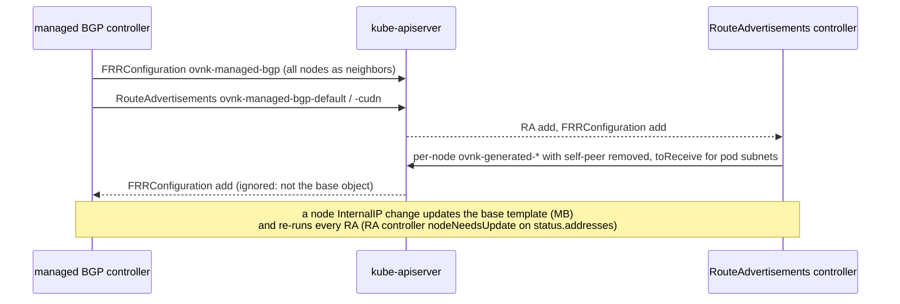

# 08 — Cluster manager: the managed BGP controller

Package `go-controller/pkg/clustermanager/managedbgp`. It exists for
no-overlay networks with `routing: managed`: instead of asking the
administrator for an `FRRConfiguration` and a `RouteAdvertisements`, the
cluster manager generates a full-mesh iBGP template between all nodes and the
RAs that use it. Line numbers refer to `controller.go` in that package.

## Contents

1. [When it runs](#when-it-runs)
2. [What it owns](#what-it-owns)
3. [Event sources and filters](#event-sources-and-filters)
4. [The reconcile: ensureManagedConfiguration](#the-reconcile-ensuremanagedconfiguration)
5. [The base FRRConfiguration](#the-base-frrconfiguration)
6. [The managed RouteAdvertisements](#the-managed-routeadvertisements)
7. [Interaction with the RouteAdvertisements controller](#interaction-with-the-routeadvertisements-controller)
8. [Limits](#limits)
9. [Tests](#tests)

---

## When it runs

`ClusterManager` creates it only when route advertisements are enabled **and**
`config.ManagedBGP.FRRNamespace` is set (`clustermanager.go:223-231`). The
namespace comes from the `[bgp-managed] frr-namespace` config section, which is
file-only (no CLI flag, `config.go:2691-2700`). Validation of that section and
the related `[no-overlay]` section is in `validateNoOverlayConfig` and
`validateManagedBGPConfig` (`config.go:2603-2727`, see
[02 — Configuration](02-configuration-and-running-modes.md)).

At `Start()` (`:141-161`) the config reconciler and, when network segmentation
is enabled, the CUDN controller are started; if the default network is
configured as managed (`isCDNManaged`, `:242-245`) an initial reconcile is
queued so the objects exist before any informer event.

---

## What it owns

All objects are tagged with the label `k8s.ovn.org/managed-bgp: ""`
(`managedNetworkLabel`, `:49`) and written with field manager
`clustermanager-managed-bgp-controller` (`:46`).

| Object | Name | Namespace | Condition to exist |
|---|---|---|---|
| Base `FRRConfiguration` | `ovnk-managed-bgp` (`types.ManagedBGPConfigurationName`) | `config.ManagedBGP.FRRNamespace` | default network managed **or** at least one managed CUDN |
| `RouteAdvertisements` | `ovnk-managed-bgp-default` | cluster | `config.Default.Transport == no-overlay && config.NoOverlay.Routing == managed` |
| `RouteAdvertisements` | `ovnk-managed-bgp-cudn` | cluster | at least one CUDN with `transport: NoOverlay` and `noOverlay.routing: Managed` |
| Label on each managed CUDN | `k8s.ovn.org/managed-bgp: ""` | | so the shared CUDN RA can select them |

The CUDN label is patched with a merge patch (`ensureManagedNetworkLabel`,
`:505-517`); the CUDN spec is immutable so the label never needs removal.

---

## Event sources and filters

Unlike the RA controller, this one registers raw informer handlers for nodes,
RAs and FRRConfigurations (`:94-122`) and funnels everything into one
key-less reconciler (`configReconciler`, key `""`). A level-driven CUDN
controller is added when network segmentation is on (`:124-135`).

| Source | Filter | Effect |
|---|---|---|
| Node add/update/delete | `nodeNeedsUpdate` (`:307-315`): InternalIP v4 or v6 changed, or add/delete | reconcile: the neighbor list changes |
| RA add/update/delete | `raNeedsUpdate` (`:317-329`): only managed RAs (name prefix `ovnk-managed-bgp-`), ignore own creations, spec changed | reconcile: repair a tampered or deleted managed RA |
| FRRConfiguration add/update/delete | `frrNeedsUpdate` (`:331-346`): only the base object by name, ignore own creations, spec or label changed | reconcile: repair the base template |
| CUDN add/update | `cudnNeedsUpdate` (`:285-305`): managed CUDNs only, ignore own label patches, label presence or value changed | `reconcileCUDN` (`:350-366`): ensure label, then reconcile |
| CUDN delete | always reconciled by the framework | `reconcileCUDN` with a missing object: reconcile so the CUDN RA is deleted when the last managed CUDN goes |

---

## The reconcile: ensureManagedConfiguration

`:372-415`. It is idempotent and derives everything from config and the CUDN
lister:

```text
cdnManaged   := config says default network is no-overlay + managed
managedCUDNs := CUDNs with transport NoOverlay and routing Managed
hasManaged   := cdnManaged || len(managedCUDNs) > 0

hasManaged     ? ensureBaseFRRConfiguration : cleanupBaseFRRConfigurations
cdnManaged     ? ensureManagedRouteAdvertisement(isCDN=true)  : deleteManagedRA(true)
len(managedCUDNs) > 0 ? ensureManagedRouteAdvertisement(false) : deleteManagedRA(false)
```

Errors are returned to the workqueue and retried with backoff.

---

## The base FRRConfiguration

`ensureBaseFRRConfiguration` (`:417-500`):

1. Reject any topology other than `full-mesh` (`:418-420`); the config
   validator already guarantees this.
2. List all nodes (`wf.GetNodes()`), and for each node add one neighbor per
   InternalIP family with `asn: config.ManagedBGP.ASNumber` (`:422-441`).
   Neighbors are sorted by address for a stable spec.
3. Desired spec: empty `nodeSelector` (applies to every node), one router
   with the managed ASN and the full neighbor list (`:447-458`).
4. Create, or update when spec or label differ.

The template therefore lists **every node's address, including the node that
will consume it**. The RA controller removes the self-peer when it generates
the per-node object (`routeadvertisements/controller.go:1353-1369`, `:1400-1403`): it
recognises the managed template by name and namespace and filters against
`util.GetNodeInternalAddrs(node)`, the same address source. The
`no-overlay.md` feature doc describes the user-visible retry behaviour when a
node has no InternalIP yet.

Because the template has no `toReceive`, route reception for the full mesh
comes from the RA controller's no-overlay branch
(`routeadvertisements/controller.go:1454-1478`), which adds every no-overlay
pod subnet as a `toReceive` prefix selector restricted to the host subnet
length. The combination is: every node advertises its `/24` and accepts
everyone else's `/24`.

---

## The managed RouteAdvertisements

`ensureManagedRouteAdvertisement` (`:519-588`). Two fixed names
(`managedRAName`, `:260-265`):

```yaml
apiVersion: k8s.ovn.org/v1
kind: RouteAdvertisements
metadata:
  name: ovnk-managed-bgp-default        # or ovnk-managed-bgp-cudn
spec:
  advertisements: [PodNetwork]
  nodeSelector: {}
  frrConfigurationSelector:
    matchLabels:
      k8s.ovn.org/managed-bgp: ""
  networkSelectors:
  - networkSelectionType: DefaultNetwork  # CDN variant
  # CUDN variant:
  # - networkSelectionType: ClusterUserDefinedNetworks
  #   clusterUserDefinedNetworkSelector:
  #     networkSelector:
  #       matchLabels:
  #         k8s.ovn.org/managed-bgp: ""
```

`targetVRF` is left unset: managed routing is always in the default VRF, so
the generated per-node objects also carry the reciprocal imports between the
default VRF and each managed CUDN VRF (see
[07](07-cm-routeadvertisements-controller.md#generatefrrconfiguration-one-source-one-node)).

The spec is compared with `reflect.DeepEqual` and rewritten when it drifts,
so manual edits are reverted. The e2e tests
`should reconcile RA CR if manually deleted in managed mode` and
`should reconcile FRRConfiguration if manually deleted in managed mode`
(`test/e2e/no_overlay.go:204`, `:253`) exercise this.

---

## Interaction with the RouteAdvertisements controller

The two controllers are decoupled through the API server:



The no-overlay validation controller
([10](10-cm-cudn-transport-and-no-overlay.md#the-no-overlay-validation-controller))
then checks that an accepted RA exists for the default network and emits
events on the default NAD.

---

## Limits

- Full mesh only: N nodes means N-1 sessions per node and O(N^2) sessions
  cluster-wide. The feature doc recommends unmanaged routing with route
  reflectors for large clusters.
- One ASN for the whole cluster (`config.ManagedBGP.ASNumber`, default
  64512), shared between the default network and all managed CUDNs.
- The base template is one object whose spec grows with the node count; every
  node change rewrites it and, through the RA controller, every generated
  object.
- There is no EVPN or VRF-Lite support in managed mode; the managed RA always
  advertises in the default VRF.

---

## Tests

`controller_test.go` in the package (1,591 lines) covers creation, update,
deletion and the filters. E2E coverage is in `test/e2e/no_overlay.go` under
the `bgp-managed` lane, which runs serially because the shared template is
mutated (`.github/workflows/test.yml:725-730`).
