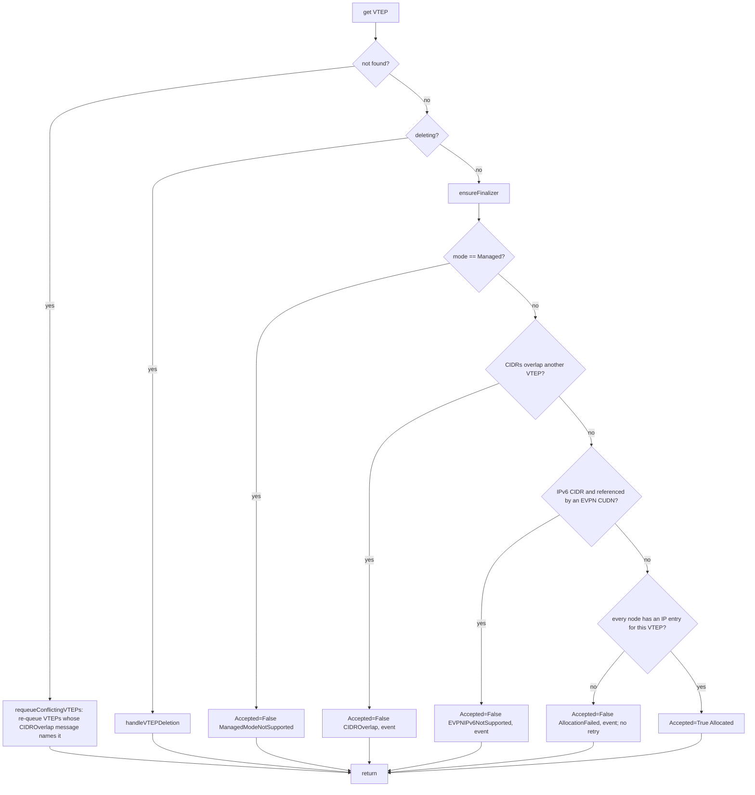

# 09 — Cluster manager: the VTEP controller

Package `go-controller/pkg/clustermanager/vtep`. It validates `VTEP` objects,
protects them with a finalizer while CUDNs reference them, and publishes the
`Accepted` condition that the CUDN controller gates on. It does **not**
allocate VTEP IPs today. Line numbers refer to `controller.go` and
`status.go` in that package.

## Contents

1. [When it runs](#when-it-runs)
2. [Sub-controllers and filters](#sub-controllers-and-filters)
3. [reconcileVTEP, step by step](#reconcilevtep-step-by-step)
4. [Validations](#validations)
5. [Deletion protection](#deletion-protection)
6. [Status writes and events](#status-writes-and-events)
7. [Who consumes `Accepted`](#who-consumes-accepted)
8. [Complexity](#complexity)
9. [Tests](#tests)

---

## When it runs

Created by `ClusterManager` when `util.IsEVPNEnabled()`
(`clustermanager.go:237-239`), which requires route advertisements, local
gateway mode and `enable-evpn` (`util/multi_network.go:2116-2118`). Started
after the RA controller (`clustermanager.go:337-341`).

---

## Sub-controllers and filters

Three level-driven controllers (`NewController`, `:58-115`), one worker each:

| Name | Watches | `ObjNeedsUpdate` | Handler |
|---|---|---|---|
| `clustermanager-vtep-controller` | VTEP | `vtepNeedsUpdate` (`:554-567`): add/delete, spec change, or non-zero `deletionTimestamp` (so finalizer removal can retry) | `reconcileVTEP` |
| `clustermanager-vtep-cudn-controller` | CUDN | `cudnNeedsUpdate` (`:518-523`): **creates** of CUDNs with an `evpn` block only | `reconcileCUDN` (`:467-482`): re-queue the referenced VTEP; `OnDelete` = `onCUDNDeleted` (`:506-512`) re-queues the VTEP of a deleted EVPN CUDN |
| `clustermanager-vtep-node-controller` | Node | `nodeNeedsUpdate` (`:547-552`): the `k8s.ovn.org/vteps` annotation changed on an update | `reconcileNode` (`:533-536`): `ReconcileAll()` on VTEPs |

The CUDN delete path uses the `OnDelete` hook because the reconcile only
receives a key and the VTEP name lives in the deleted object
(`:484-505`).

---

## reconcileVTEP, step by step

`:132-204`.

`AllocationFailed` is deliberately not retried (`:196-199`): the node
controller re-queues all VTEPs when any node's annotation changes, which is
the only way the situation resolves.

---

## Validations

### Cross-VTEP CIDR overlap (`validateCIDRsAcrossVTEPs`, `:313-359`)

Compares this VTEP's parsed CIDRs against every other VTEP's with
`util.NetworksOverlap`, skipping VTEPs that are being garbage collected
(deletion timestamp set and no finalizers). Both sides of a conflict must
report it, so the other VTEP is re-queued unless its condition already names
this VTEP in its message (`vtepNameInMessage`, `:383-395`, parses the
`[a, b]` list). When a conflict disappears, the VTEP whose message still
names this one is re-queued so it can recover. Conflicting names are sorted
for a stable message.

### IPv6 VTEPs with EVPN (`validateNoIPv6VTEPsForEVPN`, `:281-304`)

FRR does not support IPv6 VTEPs for EVPN; a VTEP with any IPv6 CIDR is
rejected only once an EVPN CUDN references it, and recovers when the last
reference goes away (`onCUDNDeleted`).

### Node coverage (`validateNodeVTEPIPs`, `:414-443`)

Every node in the cluster must carry the annotation with a non-empty entry
for this VTEP. There is no node selector on the VTEP: FRR runs on all nodes
and every node participates in every VTEP (`:529-532`). The error joins one
line per failing node, which bounds the message by the node count; the
status helper truncates at 32768 bytes (`status.go:603-606`).

---

## Deletion protection

- `ensureFinalizer` (`:212-225`) adds `k8s.ovn.org/vtep-protection` with
  server-side apply, `Force: true`, on every non-deleting VTEP.
- `handleVTEPDeletion` (`:227-254`) removes it only when
  `getCUDNsReferencingVTEP` returns nothing, then deletes the condition
  metric. While CUDNs reference it, the deletion is logged and the function
  returns nil (no retry); the next CUDN deletion re-queues it.

Consequence for the node side: devices are torn down only after the last
CUDN referencing the VTEP is gone, because the node controller keys its
cleanup on the VTEP object disappearing.

---

## Status writes and events

`updateStatusCondition` (`status.go:602-653`) applies the single `Accepted`
condition with field manager `clustermanager-vtep-controller`, `Force: true`.
It skips the API call when status, reason and message are unchanged but still
records the metric, so the gauge is correct after a restart. The last
transition time is preserved when only the reason or message change within
the same status value.

The comment at `status.go:632-636` is a warning for future changes: because
the controller applies one condition under one field manager, adding a second
condition type requires including all owned conditions in every apply.

Warning events (`CIDROverlap`, `EVPNIPv6NotSupported`, `AllocationFailed`,
`ManagedModeNotSupported`) are recorded once per distinct message
(`:161-200`, `:445-459`).

---

## Who consumes `Accepted`

| Consumer | Code | Behaviour when `False` |
|---|---|---|
| CUDN controller | `userdefinednetwork/transport_validation.go:203-222` via the VTEP notifier (`notifier/vtep.go`), which only forwards changes of the accepted value | `TransportAccepted=False/VTEPNotAccepted`; NADs are not rendered |
| RA controller | reads the VTEP object for CIDRs only (`routeadvertisements/controller.go:792-806`) | not consulted; a non-accepted VTEP with a valid annotation is still advertised |
| EVPN node controller | reads the VTEP spec only | not consulted |

Only the CUDN path gates on acceptance.

---

## Complexity

Per VTEP reconcile: O(VTEPs) CIDR parses for the overlap check, O(CUDNs) for
the reference scan (done twice: IPv6 check and, on deletion, finalizer), and
O(nodes) annotation parses. A node annotation change costs O(VTEPs) reconciles.
With tens of VTEPs and thousands of nodes the node coverage check dominates
and is linear in nodes per VTEP.

---

## Tests

`controller_test.go` (1,680 lines, Ginkgo suite) covers finalizer handling,
every status reason, cross-VTEP overlap symmetry and recovery, CUDN
create/delete re-queueing and node annotation triggers.
