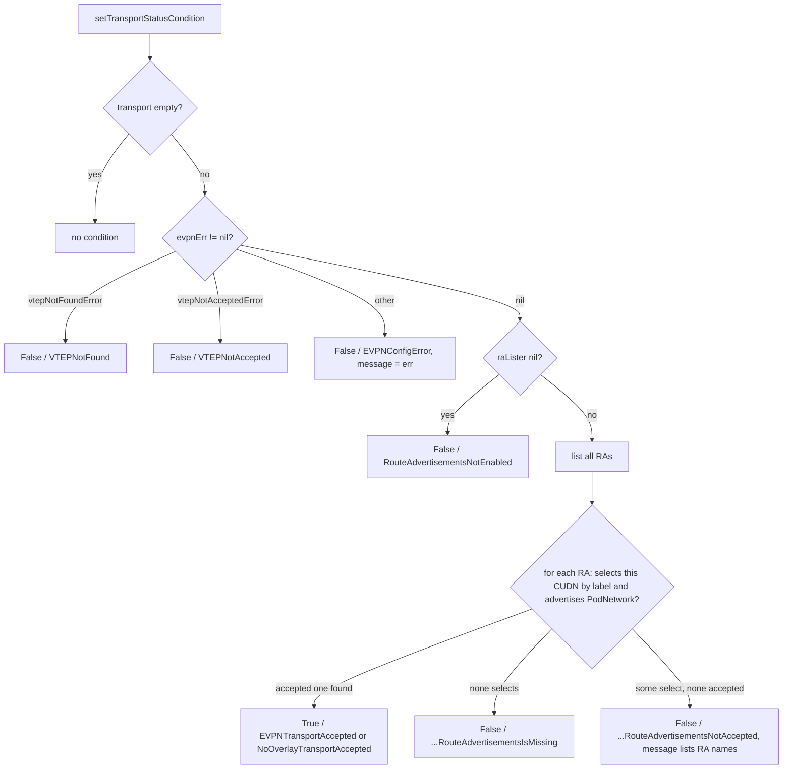

# 10 — Cluster manager: CUDN transport validation and the no-overlay validation controller

Two small pieces of the cluster manager make the dependency between a
transport-selecting CUDN and its `RouteAdvertisements` visible to users: the
`TransportAccepted` condition set by the CUDN controller, and the event-only
validation controller for the default network in no-overlay mode. This page
also covers the EVPN resources the CUDN controller owns: VID allocation and
VNI reservation.

## Contents

1. [Where the code lives](#where-the-code-lives)
2. [CUDN reconcile hooks for transports](#cudn-reconcile-hooks-for-transports)
3. [TransportAccepted decision tree](#transportaccepted-decision-tree)
4. [Notifiers: how RA and VTEP events reach the CUDN controller](#notifiers-how-ra-and-vtep-events-reach-the-cudn-controller)
5. [EVPN VID allocation and VNI reservation](#evpn-vid-allocation-and-vni-reservation)
6. [The no-overlay validation controller](#the-no-overlay-validation-controller)
7. [Sequence: EVPN CUDN acceptance](#sequence-evpn-cudn-acceptance)
8. [Review notes](#review-notes)

---

## Where the code lives

| Concern | File |
|---|---|
| CUDN reconcile, VID allocator, VNI reservation, EVPN validation, notifier callbacks | `go-controller/pkg/clustermanager/userdefinednetwork/controller.go` |
| `TransportAccepted` condition logic | `go-controller/pkg/clustermanager/userdefinednetwork/transport_validation.go` |
| VID allocation helper and render options | `go-controller/pkg/clustermanager/userdefinednetwork/controller_helper.go:328-378`, `template/render_options.go` |
| RA and VTEP notifiers | `go-controller/pkg/clustermanager/userdefinednetwork/notifier/routeadvertisements.go`, `notifier/vtep.go` |
| Default network no-overlay validation | `go-controller/pkg/clustermanager/nooverlay/controller.go` |

---

## CUDN reconcile hooks for transports

The CUDN controller is constructed with optional VTEP and RA informers
(`controller.go:206`, `:259-270`): the VTEP informer only when
`util.IsEVPNEnabled()`, the RA informer only when route advertisements are
enabled (`clustermanager.go:185-203`). Inside `reconcileCUDN`
(`controller.go:907`), the transport-related work is:

1. `validateEVPN(cudn)` (`controller.go:1344-1357`): for `transport: EVPN`,
   require `EnableEVPN`, local gateway mode, and an accepted VTEP
   (`validateVTEP`, `transport_validation.go:203-222`). Returns typed errors
   (`vtepNotFoundError`, `vtepNotAcceptedError`, `evpnConfigError`).
2. VID allocation through render options when NADs are rendered (see below).
3. `setTransportStatusCondition(cudn, evpnErr)` (`transport_validation.go:54-91`).
4. One status apply for all conditions (`updateClusterUDNStatus`).

Non-transport CUDNs (`transport == ""`) get no `TransportAccepted` condition
at all.

---

## TransportAccepted decision tree



`isRASelectingCUDN` (`transport_validation.go:179-195`) matches the RA's
`ClusterUserDefinedNetworks` label selectors against the **CUDN labels**.
This is a slightly different test from what the RA controller does (it
matches NAD labels, which are copies of the CUDN labels), but equivalent in
practice.

"Accepted" means `Accepted=True` on the RA regardless of
`observedGeneration` (`notifier.IsRAAccepted`); the stricter generation
check is only applied by the network manager.

---

## Notifiers: how RA and VTEP events reach the CUDN controller

Both notifiers are thin level-driven controllers that call a subscriber
interface:

| Notifier | Filter (`needUpdate`) | Subscriber method | What it re-queues |
|---|---|---|---|
| `udn-routeadvertisements-controller` (`notifier/routeadvertisements.go:281-337`) | add/delete; `networkSelectors`, `advertisements`, `targetVRF` or the `Accepted` value changed | `ReconcileRouteAdvertisements(raName)` (`controller.go:1393-1440`) | RA present: every no-overlay or EVPN CUDN the RA selects. RA absent (delete): every no-overlay or EVPN CUDN, because the selector is gone |
| `udn-vtep-controller` (`notifier/vtep.go:392-443`) | add/delete; `Accepted` value changed | `ReconcileVTEP(vtepName)` (`controller.go:1365-1379`) | every EVPN CUDN whose `evpn.vtep` is that name |

Both scans are O(CUDNs) per event; the code comments at
`controller.go:1359-1364` flag an indexer as the next step if this becomes
hot. `targetVRF` is in the RA filter because the Uplink feature places the
Uplink bridge in the default VRF or the UDN VRF depending on it
(`notifier/routeadvertisements.go:325-329`).

---

## EVPN VID allocation and VNI reservation

The node side needs a cluster-wide VLAN ID per MAC-VRF and per IP-VRF so
that the VLAN-to-VNI mapping is identical on every node. The CUDN controller
owns the allocator:

| Element | Code |
|---|---|
| Allocator `EVPN-VIDs` with 4095 IDs, 0 and 1 reserved at start | `controller.go:71-77`, `:214`, `:306-314` |
| Keys `macVRFKey(network)`, `ipVRFKey(network)` | `controller.go:79-87` |
| Allocation during NAD rendering, idempotent per key | `controller_helper.go:328-378`, returns `template.WithEVPNVIDs(mac, ip)` |
| Recovery from existing NAD `netconf.evpn.*.vid` on startup | `recoverEVPNIDs`, `controller.go:490-497` (uses `ReserveID` with the stored VID) |
| Release on CUDN deletion | `controller.go:518-519` |
| VNI uniqueness per VTEP: `reservedVNIs[vniKey{vtep, vni}] = network` | `controller.go:89-92`, `:528-556` |

Recovery failures do not block startup; the CUDN is enqueued for
reconciliation instead (`controller.go:321-326`), to avoid a crash loop
caused by a malformed NAD.

A VID is a precious resource: 4093 usable values per cluster, each EVPN CUDN
consuming one or two. This is the "4094 MAC-VRF + IP-VRF combinations per
VTEP" limit in the feature doc, and it is in fact cluster-wide since the
allocator is not per VTEP.

---

## The no-overlay validation controller

Package `go-controller/pkg/clustermanager/nooverlay`. Created only when
`config.Default.Transport == no-overlay` (`clustermanager.go:232-234`). It
has no status to write (the default network has no CUDN), so it emits
Kubernetes events on the default network NAD instead.

| Element | Code |
|---|---|
| Single RA watcher, `raNeedsValidation` filter: add/delete, default-network selection toggled, selectors, advertisements, `Accepted` changed | `controller.go:86-94`, `:143-166` |
| Start with an initial validation after cache sync | `controller.go:100-112`, `controllerutil.StartWithInitialSync` |
| `validate()`: find an RA that selects `DefaultNetwork`, advertises `PodNetwork` and is accepted | `controller.go:193-246` |
| `runValidation()`: emit an event only when the error string changes | `controller.go:169-190` |
| Event reasons `NoRouteAdvertisements`, `RouteAdvertisementsNotAccepted`, `NoOverlayConfigurationError`, `NoOverlayConfigurationReady` on `config.Default.ClusterDefaultNetworkNAD` | `controller.go:40-45`, `:248-308` |

It is purely observational: nothing in the datapath waits for it.

---

## Sequence: EVPN CUDN acceptance

```mermaid
sequenceDiagram
    participant U as user
    participant API as apiserver
    participant VC as VTEP controller
    participant CC as CUDN controller
    participant RC as RA controller
    participant NM as network manager (zones, nodes)

    U->>API: VTEP (Unmanaged)
    VC->>API: finalizer; Accepted=False AllocationFailed (nodes not annotated yet)
    Note over API: ovnkube-node on each node annotates k8s.ovn.org/vteps
    VC->>API: Accepted=True Allocated
    U->>API: RouteAdvertisements selecting label evpn=enabled
    RC->>API: Accepted=False ConfigurationPending: no networks selected
    U->>API: CUDN transport=EVPN, evpn.vtep=<vtep>, label evpn=enabled
    CC->>CC: validateEVPN: VTEP accepted
    CC->>CC: allocate VIDs, reserve VNIs
    CC->>API: NAD per namespace with transport=evpn, evpn{...vid}
    CC->>API: TransportAccepted=False EVPNRouteAdvertisementsIsMissing or NotAccepted
    API-->>RC: NAD add -> ReconcileAll
    RC->>API: per-node FRRConfiguration with l2vpn evpn raw config, VTEP host routes
    RC->>API: NAD annotation k8s.ovn.org/route-advertisements=["<ra>"]
    RC->>API: RA Accepted=True
    API-->>CC: RA notifier (Accepted changed) -> ReconcileRouteAdvertisements
    CC->>API: TransportAccepted=True EVPNTransportAccepted
    API-->>NM: NAD annotation change -> NetInfo advertised VRFs
```

Order of RA and CUDN creation does not matter: whichever comes last
triggers the other through the NAD and RA notifications.

---

## Review notes

- `TransportAccepted` is computed from the **RA status**, so a change to how
  the RA controller writes `Accepted` (for example a new condition type)
  must be mirrored in `notifier.IsRAAccepted` and the RA notifier filter.
- The no-overlay validator keeps `lastValidationError` in memory only; after
  a restart it re-emits the current state once (`runValidation` from
  `StartWithInitialSync`).
- VID recovery depends on `netconf.evpn.*.vid` surviving in NADs. A change
  to the NAD netconf serialisation must keep `vid` round-trippable
  (`cni/types/types.go:223-225`).
