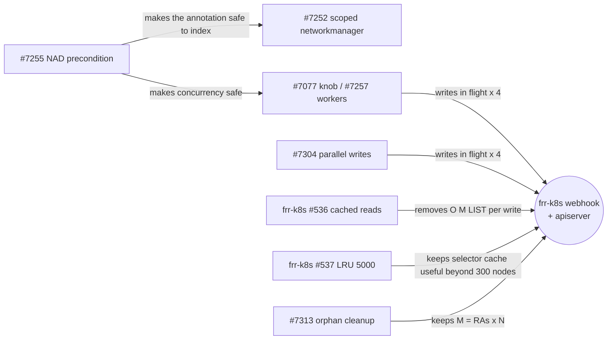

# BGP/EVPN Open Pull Requests: Bottleneck Briefing

**2026-11-19, updated 2026-11-23 and 2026-11-25**

!!! note "Update 2026-11-25, evening: H13 measured, #7257 merged"

    Run [45667397809](https://github.com/ovn-kubernetes/ovn-kubernetes/actions/runs/45667397809)
    completed the seeded lane for the first time. Full numbers are in
    [lane report 11](11-lane-report-20261125.md).

    **Admission grows with the configurations that already exist.** With 1,000 inert
    FRRConfigurations seeded before the RAs, admission rose from 91 to 158 ms per write. Webhook
    CPU per write rose from 32 to 88 ms. That is about 67 ms per 1,000 existing objects, from two
    points. Extended linearly, it reaches the 407 ms frr-k8s #536 reports downstream at about
    5,000 objects. Hypothesis 13 holds, and #536 is the lever for it.

    **The parallelism slowdown tracks CPU throttling.** The webhook was throttled in 0%, 18% and
    32% of CFS periods at one, two and four workers, while admission read 91, 106 and 171 ms.
    With the seeds it was throttled 37% at one worker. The 500m limit is now the likely cause,
    though only raising it would confirm that.

    **The webhook runs out of memory at 20 writes per second.** The first seeded attempt
    OOM-killed it against its 128Mi limit with about 800 seeds, and it crash-looped for an
    hour. Each admission lists every existing configuration, so its memory grows with the
    objects and with the admissions in flight. The lane now seeds 1,000 at 5 per second.

    **#7257 merged on 2026-11-25**, so master reconciles RouteAdvertisements with four workers.
    The throttled configuration above is now the default. #7077 was rebased onto it: its knob
    defaults to 4, and every lane but the two threadiness lanes pins one worker so the runs stay
    comparable. They do: three runs agree on 98 to 104 ms per write.

!!! note "Update 2026-11-25: second means run, admission measured"

    Run [45302750158](https://github.com/ovn-kubernetes/ovn-kubernetes/actions/runs/45302750158)
    is the first with the admission and write queries. Six lanes ran; the seeded lane failed on
    a template bug, since fixed (see [recommendation 1](#1-isolate-the-webhook-term-h13-highest-priority)).

    **Admission is about 90 of the 95 ms a write takes.** The apiserver's own share is about
    5 ms. At one worker, RA throughput is set by the frr-k8s webhook, not by ovn-kubernetes,
    which makes frr-k8s #536 (407 ms to 16 ms downstream) the largest lever in this set by
    measurement, not just by inference. Admission stays at 90 ms from 120 to 480 objects, so
    this run neither confirms nor refutes the O(M) slope of hypothesis 13.

    **The parallelism contention is in admission.** Admission rises with workers in step with
    the write: 90, 106 and 174 ms at one, two and four workers. The webhook container has a
    500m CPU limit, and with four workers it must average at least 0.47 cores during the
    burst. CPU throttling is the leading suspect and is now queried.

    **#7138, merged 2026-11-20 and not in the original list, adds one reconcile per RA.** The
    RA controller requeues each RA when the informer sees its NAD intent patch, and that pass
    writes nothing. Reconciles per RA double and the mean per reconcile halves; the cost per
    write and the total work do not move (99 ms, within 2% of run 43959763061). The report now
    normalises by writes. See [what the numbers support](#what-the-numbers-support).

    **#7320 merged on 2026-11-24.** As predicted, it changes nothing in these lanes.

!!! note "Update 2026-11-23"

    **#7252 merged on 2026-11-20, ahead of #7255.** That is the order
    [How the PRs interact](#how-the-prs-interact) warned against. The networkmanager
    now enqueues only the networks whose NADs list an RA. While #7255 is open, a
    lost annotation entry means a network that is silently skipped until resync,
    not extra work. The window still needs two RAs sharing a NAD within the
    informer's lag at one worker, so this is a correctness exposure rather than a
    regression any current lane can show. #7255 is the fix, and it now heads the
    merge order. Nothing else has merged.

    **Hypothesis 13 now has in-lane evidence.** The webhook's CPU, already
    collected by cAdvisor, rises per write with the number of existing
    configurations; see [the new table](#webhook-cpu-per-write-from-existing-artifacts).

What the eleven open PRs in ovn-kubernetes and frr-k8s do about the bottlenecks in
[03 — Bottleneck Analysis](03-bottlenecks.md), what each should change once merged, which
metric will show it, and what to analyse next.

---

## Contents

1. [Executive summary](#executive-summary)
2. [The measured baseline these PRs act on](#the-measured-baseline-these-prs-act-on)
3. [A bottleneck missing from 03: the frr-k8s admission webhook](#a-bottleneck-missing-from-03-the-frr-k8s-admission-webhook)
4. [The PRs, by bottleneck](#the-prs-by-bottleneck)
5. [How the PRs interact](#how-the-prs-interact)
6. [Metrics to observe after merge](#metrics-to-observe-after-merge)
7. [Coverage: what no open PR touches](#coverage-what-no-open-pr-touches)
8. [Recommended next analysis](#recommended-next-analysis)
9. [Corrections owed to 03](#corrections-owed-to-03)
10. [Caveats](#caveats)

---

## Executive summary

**The open PRs all work on one cost.** Eight of the eleven reduce how long it takes to turn
RouteAdvertisements into generated FRRConfigurations. That latency is the product of three
factors:

```
last RA accepted  ≈  RAs x nodes x t_write / effective_parallelism
```

- **Fewer writes**: #7313 removes leaked objects. Nothing open reduces RAs x nodes itself.
- **Cheaper writes**: frr-k8s #536, #529 and #537 lower `t_write`, most of which is admission
  webhook time.
- **More writes at once**: #7257 or the threadiness knob in #7077, and #7304, raise
  parallelism.

The rest are correctness prerequisites (#7255), a sibling fan-out on the consumer side
(#7252), a CPU fix for broad selectors (#7320), and a node-side import fix (#7250).

**The first real means change three readings in the November briefing.** Run
[43959763061](https://github.com/ovn-kubernetes/ovn-kubernetes/actions/runs/43959763061),
the first to record `_sum / _count` ([10 — Lane Report](10-lane-report-20261116.md)), shows
that:

1. **Four workers cut mean queue wait 3.5x**, not 2.06x. Per-item work rose 1.75x rather
   than doubling, so throughput rose 2.3x. The November "work doubles" was an artefact of the
   bucket layout.
2. **Each FRRConfiguration write costs about 100 ms in kind** at one write in flight, flat
   from 120 to 480 existing objects. At four in flight it rises to 177 ms. That 75% rise is
   the contention that limits every parallelism PR, and it sits on the server side: cluster
   manager CPU stays under 5%.
3. **Wasted reconciles are almost free at this scale.** The churn lane did 4.8x the
   reconciles of `deep` and used the same total worker time (48.6 s against 48.7 s). Of its
   reconciles, 79% wrote nothing. Hypothesis 1 is confirmed as amplification. Its cost, though,
   only shows up once the cost of generating each reconcile (hypothesis 2) or the population
   grows. It does not show up at 12 nodes and 40 RAs.

**The frr-k8s admission webhook is the dominant per-write cost at production scale, and 03
does not list it.** Downstream OpenShift runs (24 nodes, 300 RAs) report a 60-minute p99 for RA
acceptance, more than 90% of it spent in the webhook. The model above, with the 407 ms mean
admission latency reported in frr-k8s #536, predicts 49 minutes. Our lanes cannot see this
term: no metric profile queries admission latency, and a 480-object lane is too small for it
to grow. Proposed as **hypothesis 13** below.

**Recommendation.** First instrument and isolate the webhook term, with a seeded-object lane
that grows the existing FRRConfiguration count without growing RAs. Then run the merged PRs as
one composed A/B matrix. Running them one at a time would double-count the gains, because they
compete for the same server-side capacity. No open PR narrows `ReconcileAll()` in the RA
controller, and nothing touches EVPN.

---

## The measured baseline these PRs act on

From [10 — Lane Report 2026-11-16](10-lane-report-20261116.md). All figures are means; p99s
from these histograms only locate a value within a power-of-two bucket and are not used here.

| Lane | Nodes | RAs | Workers | Wait mean | Work mean | Work / node | Reconciles | `unchanged` |
|---|---|---|---|---|---|---|---|---|
| density | 6 | 20 | 1 | 5.31 s | 0.592 s | 0.0987 s | 20 | 0 |
| wide | 12 | 20 | 1 | 10.90 s | 1.180 s | 0.0983 s | 20 | 0 |
| deep | 12 | 40 | 1 | 22.29 s | 1.218 s | 0.1015 s | 40 | 0 |
| churn | 12 | 40 | 1 | 3.47 s | 0.255 s | — | 193 | 1,836 (79%) |
| threads | 12 | 40 | 4 | 6.35 s | 2.128 s | 0.1773 s | 40 | 0 |

### What the numbers support

**Work is one write per node at about 100 ms each.** Work per node is 0.098 to 0.102 s across
a 2x change in nodes and a 4x change in existing objects (120 to 480). At this scale the cost
of a write does not depend on how many objects already exist.

**Wait is pure serialisation.** `wait / (RAs x work)` is 0.448 to 0.462 on the three creation
lanes. A burst drained through one worker predicts 0.5, since the average item waits behind
half the queue. Mean wait is therefore about `0.46 x RAs x nodes x 0.1 s`. The last item waits
about twice that.

**Four workers give 2.3x throughput, not 4x.** Mean wait falls 3.5x and work per item rises
1.75x, so per-write latency goes from 101 ms to 177 ms with four writes in flight. The cluster
manager peaks at 4% CPU and its client-side rate limiter was measured at under 1 ms in
October, so the contention is in the apiserver, the webhook or etcd. The data cannot yet say
which, because none of the three is queried (see
[hypothesis 13](#a-bottleneck-missing-from-03-the-frr-k8s-admission-webhook)). This matches the
remark on #7257 that eight workers "didn't buy much extra speed".

**A wasted reconcile costs milliseconds.** Total worker time on churn is 193 x 0.252 s =
48.6 s. On `deep` it is 40 x 1.218 s = 48.7 s. The 150-odd extra reconciles fit within the
difference, so each costs a few milliseconds at most: regenerate twelve objects, run
`DeepEqual`, write nothing.

**The same holds after #7138, once work is counted per write.** Run 45302750158 runs on a
controller that reconciles every RA a second time, so its per-reconcile means halve. Divided
by real writes (create, update, delete), total work gives:

| Lane | Workers | Reconciles | Writes | Total work | Work / write | Wait / total work |
|---|---|---|---|---|---|---|
| density | 1 | 40 | 120 | 11.9 s | 99.4 ms | 0.464 |
| wide | 1 | 40 | 240 | 23.8 s | 99.2 ms | 0.474 |
| deep | 1 | 80 | 480 | 47.8 s | 99.6 ms | 0.472 |
| churn | 1 | 221 | 480 | 48.9 s | 102.0 ms | — |
| threads2 | 2 | 81 | 480 | 56.2 s | 117.2 ms | 0.219 |
| threads | 4 | 81 | 480 | 90.6 s | 188.8 ms | 0.098 |

The fit spread falls to 0.5% for work per write and 2.2% for the queue factor. The 2-worker
midpoint shows the contention is not linear in writes in flight: per-write cost rises 18% from
one to two workers and 61% more from two to four, so throughput is 1.7x at two workers and
2.1x at four.

### Extrapolation

These predictions hold only while `t_write` stays at the kind figure. The next section
explains why it does not stay there.

| Shape | Objects | Last RA accepted at 100 ms/write, 1 worker | at 407 ms/write |
|---|---|---|---|
| 24 nodes x 300 RAs (downstream) | 7,200 | 12 min | **49 min** (reported: up to 60) |
| 120 nodes x 50 RAs | 6,000 | 10 min | 41 min |
| 500 nodes x 1000 RAs | 500,000 | 13.9 h | 56 h |

---

## A bottleneck missing from 03: the frr-k8s admission webhook

### Proposed hypothesis 13: FRRConfiguration admission is O(existing configurations) per write

**Priority**: Critical. **Owner**: frr-k8s, with the load landing on the apiserver.

**Mechanism.** Every FRRConfiguration create or update passes frr-k8s's validating webhook.
Before frr-k8s #536, the webhook makes a **live, unpaginated LIST** of every FRRConfiguration
and every Node per admission. It then resolves the node selector of every existing
configuration to build each node's merged config and check for conflicts. The ovn-kubernetes
controller blocks on each write, and before #7304 it writes serially.

**Why it scales badly.** Admission cost grows with M, the existing configurations, and
ovn-kubernetes creates M = RAs x nodes of them. Creating all of them therefore costs O(M²) in
admission work and O(M²) in LIST bytes served by the apiserver. Every parallelism PR
multiplies the number of LISTs in flight.

**Evidence so far.**

| Source | Observation |
|---|---|
| frr-k8s #536, downstream | Mean admission latency 407 ms falls to 16 ms with cached reads, "while creating thousands of FRRConfigurations" |
| #7304 discussion, downstream | 24 nodes, 300 CUDNs, 300 RAs: p99 RA acceptance up to 60 min, "90%+ of that time is the webhook" |
| #7257 description, downstream | At 1 worker, `ra-0` to `ra-74` were accepted by 288 s. That is 1,800 writes at about 160 ms each, early in the burst when M was small. The 407 ms average over the full run implies per-write cost rising with M |
| Our lanes | Per-write cost flat at about 100 ms from M = 120 to 480. Too small to see the term |

The two environments agree on shape. Write cost is flat at small M, so it holds still in our
lanes. It grows by M in the thousands, so it dominates downstream. Neither environment has
measured the curve between those points.

#### Webhook CPU per write, from existing artifacts

The webhook runs in the `frr-k8s-statuscleaner` pod, and the lanes' cAdvisor queries already
record its CPU. Integrated over each RA job and divided by the FRRConfigurations written, run
43959763061 gives:

| Lane | Objects written | Webhook CPU / write | apiserver CPU / write | Cluster manager CPU, total |
|---|---|---|---|---|
| density | 120 | 15.7 ms | 145.7 ms | 0.94 core-s |
| wide | 240 | 17.5 ms | 98.5 ms | 2.29 core-s |
| deep | 480 | 28.2 ms | 99.7 ms | 3.55 core-s |
| threads | 480 | 30.0 ms | 86.9 ms | 3.40 core-s |

**Webhook CPU per write rises with the existing count. apiserver CPU per write does not.**
From 240 to 480 objects the slope is about 44 µs per existing configuration. Extrapolated
linearly to the 7,200 objects of the downstream shape, that gives about 330 ms of CPU per
admission, against the 407 ms mean latency #536 reports. During the deep RA job the webhook
peaks at 30% of a core, ten times the cluster manager's peak.

The integration includes each job's idle time, so the small lanes read slightly high. The
slope rests on three points. Latency is not CPU. The seeded lane exists to replace this
estimate with a measured curve.

#### Admission measured, run 45302750158

| Lane | Workers | Written | Admission mean | Write mean | Webhook CPU / write |
|---|---|---|---|---|---|
| density | 1 | 120 | 90.6 ms | 95.1 ms | 17.3 ms |
| wide | 1 | 240 | 89.8 ms | 94.8 ms | 14.6 ms |
| deep | 1 | 480 | 90.2 ms | 95.2 ms | 30.4 ms |
| threads2 | 2 | 480 | 106.5 ms | 112.3 ms | 27.4 ms |
| threads | 4 | 480 | 173.7 ms | 180.4 ms | 22.3 ms |

**Admission is 95% of the write at every worker count.** The webhook spends 15 to 30 ms of CPU
on each, so most of its 90 ms is waiting: the two live LISTs, or the CPU limit below. Admission
does not move between 120 and 480 objects. The 44 µs-per-object CPU slope above would add only
about 16 ms over that range, within what this run can resolve, so H13's slope is still
unmeasured. The webhook CPU per write is too noisy to carry it: density now reads higher than
wide.

**Not the client rate limit.** The webhook reads through controller-runtime's API reader at 20
requests per second, two per admission, so about 10 admissions per second. Four workers
sustained about 22, so that limiter is not what binds.

**The CPU limit is the leading suspect.** frr-k8s's manifest gives the webhook container
`limits.cpu: 500m`. With four workers it used about 10.7 core-seconds on 480 writes, in a burst
no shorter than 22.7 s (total worker time over four workers), so at least 0.47 cores on
average. That is at the limit, and admission latency doubles while CPU per write falls, which
is what CFS throttling looks like. `frrWebhookThrottledPeriodRate` over `frrWebhookPeriodRate`
now measures it: run 45667397809 read 0%, 18% and 32% throttled at one, two and four workers.

**Confirm with.** `apiserver_admission_webhook_admission_duration_seconds` for the
FRRConfiguration webhook, and `apiserver_request_total{resource=~"frrconfigurations|nodes",
verb="LIST"}`, plotted against existing FRRConfiguration count. Our profiles contain neither
query today.

**Candidate fixes.** frr-k8s #536, #529 and #537, described below. On the ovn-kubernetes side,
writing fewer objects is the structural fix (03 hypothesis 3, candidate fix 2).

---

## The PRs, by bottleneck

State as of 2026-11-25.

| PR | Repo | Title | Bottleneck | Review state |
|---|---|---|---|---|
| [#7077](https://github.com/ovn-kubernetes/ovn-kubernetes/pull/7077) | ovnk | BGP RA density lanes | Measurement; carries the threadiness knob | Changes requested; the reviewer's question has been answered. Rebased onto #7257 on 2026-11-25 |
| [#7257](https://github.com/ovn-kubernetes/ovn-kubernetes/pull/7257) | ovnk | RA controller with four workers | H12 | **Merged 2026-11-25** |
| [#7304](https://github.com/ovn-kubernetes/ovn-kubernetes/pull/7304) | ovnk | Parallelise FRR config writes | H12 / H13 | Review required again after the approval lapsed |
| [#7255](https://github.com/ovn-kubernetes/ovn-kubernetes/pull/7255) | ovnk | Lost NAD annotation updates | Correctness prerequisite for H12 and #7252 | Changes requested (shorten comment, fold tests) |
| [#7252](https://github.com/ovn-kubernetes/ovn-kubernetes/pull/7252) | ovnk | Scope RA update reconciliation in networkmanager | H1, consumer side | **Merged 2026-11-20**, before #7255 |
| [#7320](https://github.com/ovn-kubernetes/ovn-kubernetes/pull/7320) | ovnk | Filter generated configs before sort | H2 x H3 | **Merged 2026-11-24** |
| [#7138](https://github.com/ovn-kubernetes/ovn-kubernetes/pull/7138) | ovnk | Handle node failures without blocking other nodes | H1 (adds a confirmation pass per RA) | **Merged 2026-11-20**; not in the original list |
| [#7313](https://github.com/ovn-kubernetes/ovn-kubernetes/pull/7313) | ovnk | Clean up orphaned FRR configs on startup | H3 hygiene | Approved |
| [#7250](https://github.com/ovn-kubernetes/ovn-kubernetes/pull/7250) | ovnk | Kernel-side route dump filtering | H7 | In review; kernel ≥ 5.7 versus fallback unresolved |
| [frr-k8s#536](https://github.com/metallb/frr-k8s/pull/536) | frr-k8s | Cached admission reads | H13 | Open, no reviews |
| [frr-k8s#529](https://github.com/metallb/frr-k8s/pull/529) | frr-k8s | Resolve each selector once per admission | H13 | Open, no reviews |
| [frr-k8s#537](https://github.com/metallb/frr-k8s/pull/537) | frr-k8s | Size the selector cache for per-node configs | H13 | Open, no reviews |

### H12 — parallelism: #7257, the #7077 knob, #7304

**#7257** hardcodes `Threadiness: 4` on the RA controller. **#7077** (commit `76f6ba1d0`)
instead adds `--cluster-manager-route-advertisements-threadiness`, default 1. The #7257
author has proposed abandoning it for the knob, with the value set downstream.
**Status 2026-11-25**: #7257 merged instead, and #7077's knob was rebased to default to 4.
**#7304** is orthogonal to both. Inside one reconcile it issues up to four creates or updates
concurrently, waits for all of them, and only then deletes obsolete configurations serially.

| | Expected outcome | Basis |
|---|---|---|
| Knob = 4 | Mean wait down about 3.5x, throughput about 2.3x, RA acceptance p50 down about 3x | Measured in our threads lane; #7257 measured p50 114 s to 34 s downstream |
| #7304 alone | Work per reconcile from `N x t(1)` to `ceil(N/4) x t(4)`. At 12 nodes that is 1.22 s to about 0.53 s, also about 2.3x | Assumes per-write contention at four writes in flight matches four workers, since both put four writes in flight |
| Both | Up to 16 writes in flight. **Not multiplicative.** Expect saturation | Per-write latency already rises 75% at four. The 8-worker remark on #7257 |

Before #536, every extra write in flight is another live LIST of all FRRConfigurations and
Nodes. Parallelism then raises apiserver LIST load in proportion to writes in flight x M. That
is exactly the place where the 75% contention is suspected.

### H13 — cheaper admission: frr-k8s #536, #529, #537

| PR | Change | Expected effect on the ovn-kubernetes path |
|---|---|---|
| **#536** | Webhook reads Nodes and FRRConfigurations from informer caches, with nodes transformed down to metadata | **The largest single lever in this set.** Removes the O(M) LIST per admission. 407 ms to 16 ms measured downstream. Trade-off: admission becomes eventually consistent, and node controllers still validate the merged config before applying it |
| **#529** | Resolve each existing config's selector once per admission rather than once per (matching node, config) | **No effect on generated configs**: each selects exactly one node, so N = 1. Helps source configs selecting many nodes, which are written rarely |
| **#537** | Selector LRU from 300 entries to 5,000 | Once #536 removes the LIST, selector conversion becomes the main admission CPU cost. Above 300 nodes, each admission scans more distinct hostname selectors than the LRU holds and evicts them before reuse, so nearly every lookup misses. **Invisible below 300 nodes.** About 1.9 MB of heap at 5,000 nodes |

### H1 — fan-out: #7252, and what it does not cover

**#7252** indexes NADs by their `k8s.ovn.org/route-advertisements` annotation. On an RA update,
networkmanager then enqueues only the networks whose NADs reference that RA, instead of every
network. This is the same `ReconcileAll` pattern as 03 hypothesis 1, but in the consumer, not
in the RA controller.

- **Expected**: networkmanager reconciles per RA change fall from O(networks) to O(networks
  selected by that RA). The per-network sync costs O(NADs + RAs x N) (developer guide 18), so
  each skipped network saves real work.
- **Not covered**: node label changes still resync every network (raised by a reviewer, noted
  by the author for follow-up). The RA controller's own `ReconcileAll()` on Node, UplinkState,
  FRRConfiguration and NAD events (03 H1 table) is untouched by any open PR.
- **Dependency**: the index is only as correct as the annotation. Today a lost update means
  extra work. Once the annotation drives skipping, a lost update means a **silently skipped
  network**. #7255 closes that.

### Correctness prerequisites: #7255, #7313

**#7255** preconditions the NAD annotation patch on the cached `resourceVersion`. On a 409 it
requeues the RA, so the whole reconcile re-runs from a fresh cache. It adds no API calls in the
normal case.

- **Expected**: no change in disjoint-selector lanes (zero conflicts, measured). With
  overlapping selectors and more than one worker, occasional conflicts and retries in place of
  silent loss.
- **Why it gates H12**: one worker hides the race behind lister staleness. Four workers make
  the interleaving routine. No threadiness default should move without it.

**#7313** finds generated FRRConfigurations whose RA no longer exists, at startup, and queues
those RAs for deletion.

- **Expected**: after a cluster-manager restart, the generated count returns to exactly RAs x
  N. Leaked objects matter for performance as well as hygiene: each one adds to M in every
  future admission (H13) and to the `List` that #7320 filters.

### H2 x H3 — #7320

`generateFRRConfigurations` lists every FRRConfiguration the RA's `frrConfigurationSelector`
matches, sorts the list, and only then skips `ovnk-generated-` objects. With an empty or broad
selector, that list includes every generated object, so each reconcile sorts O(RAs x N) items.
That is O(RAs² x N log) over a burst. #7320 filters before sorting.

- **Expected**: lower cluster-manager CPU per reconcile, **only with broad selectors**.
- **No effect in our lanes, by construction**: lane RAs select `name: receive-all`, and
  generated objects carry only the `k8s.ovn.org/route-advertisements` label
  (`pkg/clustermanager/routeadvertisements/controller.go`, L1725).
- **Residual**: the lister still walks every cached object, so selection stays O(generated)
  per reconcile. The author measured a label-requirement selector as slower (3.4 ms against
  2.0 ms), because the lister has no label index. A real index is the follow-up.

### H7 — #7250

`getBGPRoutes` already streams routes through `RouteListFilteredIter`, but the kernel sends
every route and the filter runs in userspace after deserialisation. #7250 sets
`NETLINK_GET_STRICT_CHK` so the kernel applies table and protocol filters itself, and falls
back to userspace filtering for filters the kernel cannot express.

- **Expected**: less ovnkube-node CPU and allocation per `syncNetwork`, in proportion to the
  fraction of routes on the node outside the requested table and protocol. The largest gains
  come with many VRF tables (VRF-Lite, EVPN IP-VRFs). Little gain when everything lives in the
  main table.
- **Not changed**: the algorithm stays a full dump plus full LRSR scan plus diff per network
  per 500 ms window (03 H7). This fixes the constant, not the shape.
- **Cost**: kernel 5.7 or later becomes a hard requirement unless reviewers ask for a fallback.

---

## How the PRs interact



| Pair | Interaction | Consequence |
|---|---|---|
| #7304 + knob | Both add writes in flight to the same server-side path | Measure the combination. Do not multiply the individual gains |
| #7304 / knob before #536 | Each write in flight is a live LIST of all configs and nodes | Parallelism raises apiserver load in proportion to writes in flight x M. Prefer #536 to land first or alongside |
| #536 + #537 | #536 makes selector work the dominant admission cost. #537 keeps it cached above 300 nodes | Same mechanism; #537 only pays off after #536 |
| Knob > 1 without #7255 | Lost-update window becomes routine with overlapping selectors | #7255 must merge first |
| #7252 without #7255 | A lost annotation entry becomes a skipped network | #7255 first |

**Suggested merge order:** #7255 (now urgent, since #7252 has merged), then #7313
(independent and low risk; #7320 has merged), then frr-k8s #536, then #7304 and the knob.
#7250 and frr-k8s #529 and #537 are independent. Run 45302750158 strengthens the case for #536
before any parallelism: admission is where the extra writes in flight queue.

---

## Metrics to observe after merge

All rates and durations as means (`rate(_sum) / rate(_count)`), not p99s.

### Already in `contrib/perf/metrics-ovnk.yml`

| PR | Metric (`metricName`) | Expected movement |
|---|---|---|
| Knob, #7257 | `ovnkubeWorkqueueQueueDurationMean`, RA controller | Down about 3.5x at 4 workers |
| Knob, #7257 | `ovnkubeWorkqueueWorkDurationMean`, `raReconcileDurationMean` | Up about 1.75x (the contention signature) |
| #7304 | `raReconcileDurationMean` | Down about 2.3x at 12 nodes. The gain grows with N up to the writes-in-flight cap |
| #7255 | `ovnkubeWorkqueueRetryRate`, RA controller | Zero in disjoint lanes; small and non-zero in an overlap lane with workers > 1 |
| #7313 | `raGeneratedFRRConfigurations` after a controller restart | Equals RAs x N; `raFRRConfigurationProcessed{op="delete"}` rises once at startup |
| #7252 | `ovnkubeWorkqueueAddRate` for the networkmanager controller | Adds per RA change fall from O(networks) to O(selected networks) |
| #7250 | `routeImportSyncDuration99th`. **A mean query is needed**: the p99 read 57 ms to 1,014 ms across lanes with no pattern | Down only where many non-matching routes exist |
| All | `bgpCRObjectCount{resource="frrconfigurations..."}` | Unchanged; guards against leaks |

### To add, needed to see H13 and the contention

The admission, write and LIST queries and `routeImportSyncDurationMean` are in #7077's lanes as
`frrAdmissionDurationSumRate`, `frrWriteDurationSumRate`, `frrRelatedListRate` and their
count companions, with `frrWebhookThrottledPeriodRate` for the webhook's CPU limit. The
in-flight and rest-client queries are still to add.

| Query | Why |
|---|---|
| `apiserver_admission_webhook_admission_duration_seconds_{sum,count}{name=~".*frrconfiguration.*",operation=~"CREATE\|UPDATE"}` | Splits `t_write` into admission and storage. The primary metric for #536, #529 and #537 |
| `apiserver_request_duration_seconds_{sum,count}{resource="frrconfigurations",verb="POST"}` | The full write as the server sees it; compare with admission |
| `sum by (resource) (rate(apiserver_request_total{resource=~"frrconfigurations\|nodes",verb="LIST"}[1m]))` | Webhook LIST rate. Should fall to about zero with #536 and rise with writes in flight without it |
| `apiserver_current_inflight_requests{request_kind="mutating"}` | Confirms writes in flight under the knob and #7304 |
| frr-k8s webhook container CPU and memory (cAdvisor) | #536 trades LIST traffic for cache memory; #537 adds about 2 MB |
| `rest_client_request_duration_seconds` on the cluster manager (roadmap Activity 1.4b) | Excludes client-side throttling as a cause of the contention |
| `routeImportSyncDurationMean` | Replaces the unreadable p99 for H7 |

---

## Coverage: what no open PR touches

| # | Hypothesis | Open PR | Gap |
|---|---|---|---|
| 1 | `ReconcileAll()` in the RA controller | — (#7252 is the consumer side) | Confirmed as amplification; cost unmeasured at scale |
| 2 | Generation recompute | #7320, broad selectors only | Cross-reconcile caching (the code's own TODO) untouched |
| 3 | Object explosion | #7313 hygiene only | Nothing reduces RAs x N x S |
| 4 | `FRRNodeState` size | — | 73x headroom at 40 networks; ceiling near 3,300 networks |
| 5 | `BGPSessionState` | — | Closed as a harness artefact |
| 6 | Exporter scrape cost | — | Untested |
| 7 | Route import | #7250, constant factor | Incremental apply untouched |
| 8, 8b | EVPN | — | **Nothing measured or proposed** |
| 9, 10, 11 | EgressIP, isolation, node resyncs | — | Untested |
| 12 | Threadiness | Knob, #7257 (merged), #7304 | Contention in admission; webhook CPU throttling tracks workers (0, 18, 32%); limit not yet raised to confirm |
| 13 | Webhook admission | frr-k8s #536, #529, #537 | **Confirmed**: about 67 ms per 1,000 existing configurations, two points |

---

## Recommended next analysis

Ordered by how much each removes from the uncertainty the PRs leave behind.

### 1. Isolate the webhook term (H13). Highest priority.

Without it, no PR in the parallelism or admission group can be sized, and the source of the
75% contention stays a guess.

- Add the [five queries above](#to-add-needed-to-see-h13-and-the-contention) to
  `metrics-ovnk.yml`.
- Add a **seeded lane**: before running `bgp-ra-density-deep`, pre-create M ∈ {0, 2,000,
  5,000, 10,000} inert FRRConfigurations, each selecting a hostname that does not exist. They
  pass validation trivially, but every admission still has to list and resolve them. This grows
  M without growing RAs, CUDNs or nodes, and kind can afford it. It gives the curve between our
  flat 100 ms and the downstream 407 ms.
- **Deliverable**: `t_write(M)` and `t_admission(M)`, with and without frr-k8s #536. This
  confirms or refutes H13 and tells us whether the 75% contention is webhook LIST load.
- **Status 2026-11-23**: folded into #7077 as commits `daac51365` and `ece29c6e5`
  for one CI run, to be reverted afterwards. It adds the queries, `bgp-ra-density-seeded` at M = 2,000, the 2-worker point
  from item 2, and a write-cost table in the report. All seeds share one absent hostname. The
  webhook caches selectors in a 300-entry LRU, and 2,000 distinct selectors would have mixed
  #537's large-cluster pathology into what should be the pure O(M) term. The seeds were checked
  against frr-k8s at the harness's pinned ref (`b43efcb206be`): CRD schema, strict decoding,
  and admission through the real `validateConfig`, including a generated write admitted with
  all seeds present. A #536 A/B needs `FRR_K8S_GIT_REF` pointed at that PR's head, which
  `clone_frr` cannot fetch from a fork today.
- **Status 2026-11-25**: run 45302750158 measured admission in six lanes (above), but the
  seeded lane failed before creating anything. kube-burner strips every template action from
  the raw file to learn the object's kind before rendering, which left the seed's IPv6
  neighbour as `address: 2001:db8::`, read by YAML as a mapping key. The address is now quoted
  (`1b0791a7f`); the stripped template decodes and the rendered seeds are byte-identical. The
  rerun also carries the throttling query and the per-write fit.
- **Status 2026-11-25, evening**: the rerun, run 45641195655, created seeds at 20 per second and
  the webhook was OOM-killed against its 128Mi limit with about 800 created. At 1,000 seeds and
  5 per second, run 45667397809 completed: admission went from 91 to 158 ms, about 67 ms per
  1,000 existing objects. The deliverable now needs a second seeded size, to test whether the
  growth is linear, and the #536 A/B.

### 2. Run a composed A/B matrix once the parallelism PRs merge

| | frr-k8s main | frr-k8s + #536 |
|---|---|---|
| ovnk master | baseline | admission only |
| + #7304 | | |
| knob = 4 | (measured: 3.5x wait) | |
| + #7304 + knob = 4 | | |

Run on `deep` and on the seeded lane at M = 5,000. **Falsifiable predictions**: #7304 alone
about 2.3x; #7304 with the knob well short of 5x; #536 changes nothing at M ≤ 480 and dominates
at M = 5,000. Add a 2-worker point (already planned) to separate the fixed cost from the
contention slope.

### 3. Re-rank hypothesis 1 by measuring the cost of a wasted reconcile as N grows

At 12 nodes a wasted reconcile is nearly free. The question for 03 is whether it stays that
way. It costs O(N x S x routers x P) to generate (H2), O(N) `DeepEqual`, and, under broad
selectors, a sort over O(RAs x N).

- A 6-node churn lane (already proposed) plus a churn variant driven by **node relabels**
  rather than RA recreates, which is the trigger 03 names, with pprof.
- **Deliverable**: wasted-reconcile cost against N. If it stays at milliseconds, H1 drops below
  H13 and H3. If it grows with N x RAs, narrowing `ReconcileAll()` (roadmap Activity 4.1) goes
  back to the top, and it is currently the one major fix nobody is writing.

### 4. Add a broad-selector variant to make #7320 and the H2 x H3 interaction visible

Same as `deep` but with `frrConfigurationSelector: {}`. Each reconcile then selects every
generated object. Expect reconcile CPU to grow with RAs x N before #7320 and to collapse after.
The residual O(generated) lister walk is the case for a label index.

### 5. Give hypothesis 7 a lane that can show it

Route import p99 swings from 57 ms to 1,014 ms with no pattern, and our lanes import few
routes. Needed: a mean query, and a lane where the peer announces thousands of routes into VRF
tables (VRF-Lite), so that #7250's kernel filtering and the full-diff cost both become visible.

### 6. Cheap and still owed

- **H4, third point**: an 80-RA lane, to turn the 3,300-network ceiling from a two-point line
  into a fit.
- **Overlapping selectors**: the only shape where #7255 conflicts fire, and the shape that
  decides whether threadiness results transfer to real deployments.
- **Beyond 300 nodes** (#537, H3 at scale): needs kwok (roadmap Activity 3.1). kind cannot get
  there.

EVPN (H8 and H8b) remains the largest unexamined area. It belongs in roadmap P5 once the
control-plane picture above is settled, because its dominant term (pods, not nodes) is
independent of everything here.

---

## Corrections owed to 03

Applied to [03](03-bottlenecks.md) on 2026-11-23 as dated callouts, with hypothesis 13 added
as its own section.

| Section | Previous text | Now says |
|---|---|---|
| H1 status | "still untested" | Confirmed as amplification (78 to 80% wasted across four runs); per-unit cost about zero at 12 nodes; cost at scale unmeasured |
| H2 callout | "Twenty reconciles at a 1.02 s work p99" | p99 is a bucket artefact; mean work is 0.59 s at 6 nodes, about 100 ms per write |
| H12 callout | "wait p99 16.08 s against work p99 1.02 s, a 15.8x ratio" | Means: 9.0x at 20 RAs, 18.3x at 40; four workers cut wait 3.5x and raise work 1.75x |
| Hypothesis list | Twelve entries | Add H13, the frr-k8s admission webhook |
| Ownership summary | "Five of twelve involve frr-k8s or FRR" | Six of thirteen, and the most expensive one measured downstream is frr-k8s's |

---

## Caveats

- **Four means runs.** Runs 43959763061, 45302750158, 45641195655 and 45667397809 agree on the
  cost per write within about 5% in every single-worker lane, across #7138's change to the
  reconcile count and the rebase onto #7257. The last three also agree on admission at each
  worker count within 4%. The seeded figure comes from one run.
- **kind.** Twelve nodes share one kernel, one disk and one apiserver. The 100 ms write and the
  75% contention are properties of that box. Ratios transfer better than absolute values.
- **Downstream figures are second-hand.** The 407 ms, 60 min and 288 s figures come from PR
  descriptions about OpenShift CI rehearsals, not from our artefacts. They fit the model, but
  have not been reproduced here.
- **Disjoint selectors only.** Every lane gives each RA its own network. Overlap is unmeasured.
- **Per-RA counters are dropped when an RA is deleted.** `DeleteRouteAdvertisementMetrics`
  removes every series for that name, counters and histograms included, on the reconcile
  that finds the RA gone, after that reconcile's deletes have been recorded. Summed counters
  would then undercount the churn lane. In run 43959763061 the path never fired: `create`
  and `unchanged` are monotonic, because kube-burner recreates within about a second and the
  reconcile finds the new object. The workqueue metrics, keyed by controller name, are
  unaffected and are the ground truth for counts.
- **The wasted-reconcile estimate is a difference of two totals.** It bounds the cost at a few
  milliseconds; it does not measure it. pprof on the churn lane would.

---

## References

| Document | Purpose |
|---|---|
| [03 — Bottleneck Analysis](03-bottlenecks.md) | The hypotheses this briefing maps PRs onto |
| [10 — Lane Report 2026-11-16](10-lane-report-20261116.md) | Every baseline number above, generated from run 43959763061 |
| [11 — Lane Report 2026-11-25](11-lane-report-20261125.md) | The seeded lane, throttling and admission figures, generated from run 45667397809 |
| [briefing-nov2026](briefing-nov2026.md) | The p99-based model this briefing revises |
| [05 — Roadmap](05-roadmap.md) | Activities 1.4b, 3.1 and 4.1 referenced above |
| [Developer guide 18](../../developer-guide/bgp-evpn/18-performance-and-scale.md) | Code-level cost model |
